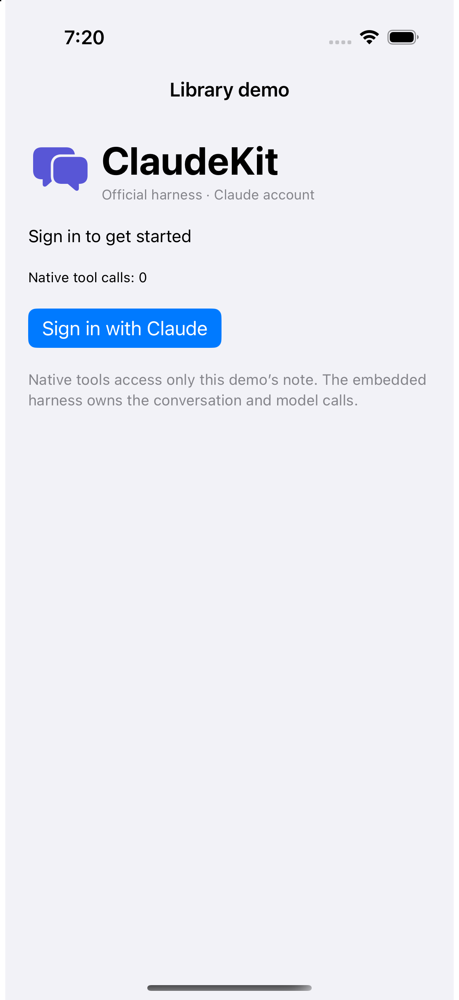

# ClaudeKit Demo App

This existing Xcode project now builds the official Claude Code harness demo with **Sign in with Claude**. Users log in with their own Claude account through the official browser flow. There are no API-key, bearer-token, or environment-variable login fields.

## Demo preview

<p align="center">
  
</p>

Sign-in screen captured during the 18 October simulator verification. Both demo projects use the same app implementation.

## Open The App

```sh
open DemoApp/AssistantRuntimeDemoApp.xcodeproj
```

Select the **AssistantRuntimeDemoApp** scheme and run on an iOS 18+ device. The project links `ClaudeKit` and `ClaudeKitUI` from the local package and compiles the shared sources under `LibraryDemo/Sources`. Run `bash Scripts/bootstrap-library.sh` from the repository root before the first build on a fresh checkout.

The bundle identifier remains `ai.claudekit.demoapp`, so rebuilding installs over the previous demo. Existing legacy files remain on disk for reference but are not compiled. The new app uses its own harness authentication and state files; it does not import old API keys or bearer tokens.

## What The App Tests

- Official Claude-account browser sign-in
- Conversation creation, switching, streaming, and restoration
- Native note read/write tools with manual approvals
- Cancellation and recovery

See [LibraryDemo instructions](../LibraryDemo/README.md) for fixture launch arguments and current alpha limitations. Both projects use the same app implementation.
