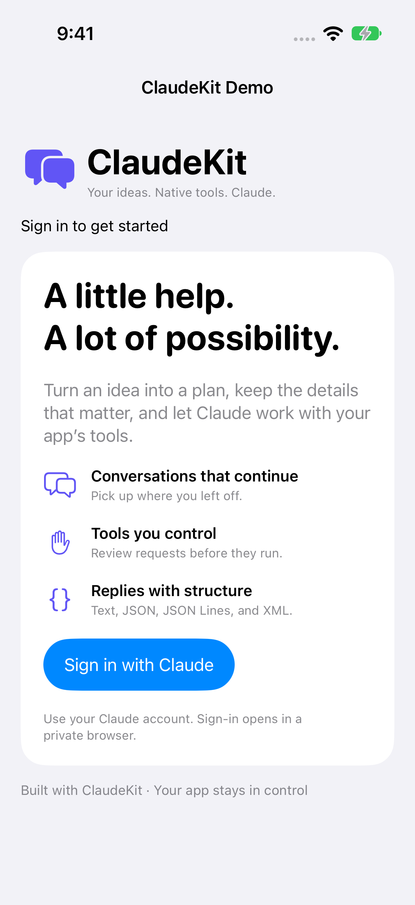
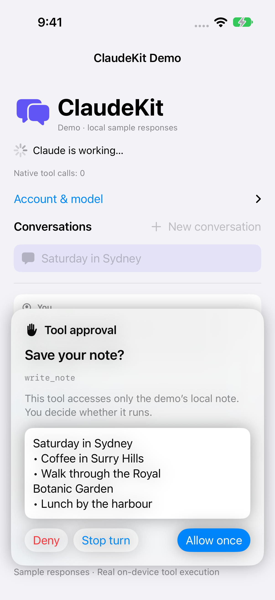
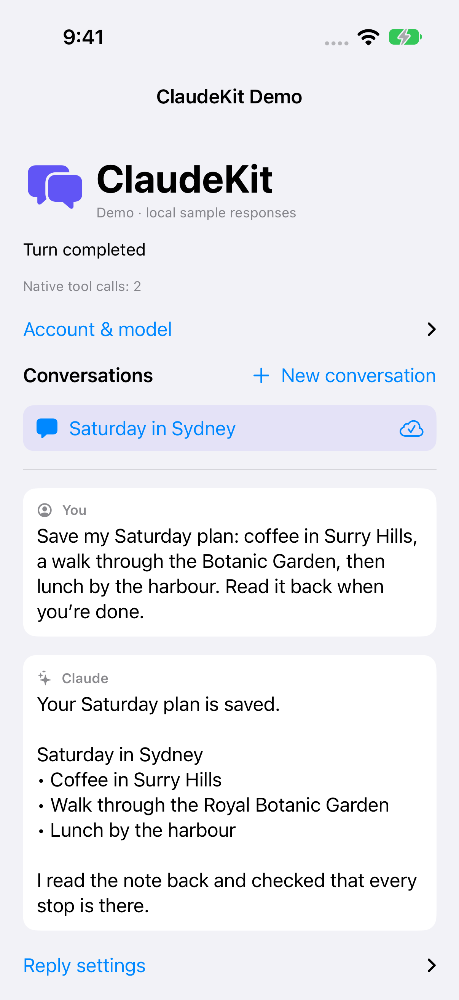
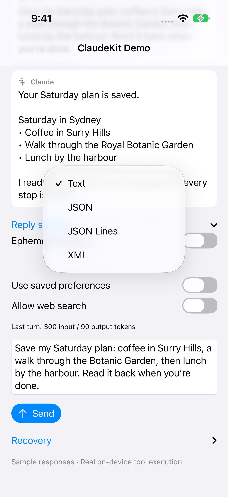
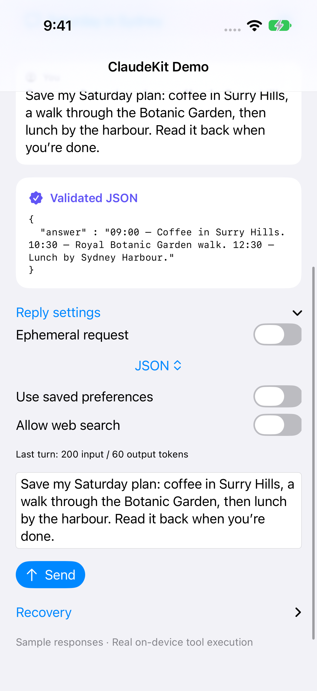

# ClaudeKit Demo App

This existing Xcode project now builds the official Claude Code harness demo with **Sign in with Claude**. Users log in with their own Claude account through the official browser flow. There are no API-key, bearer-token, or environment-variable login fields.

## Demo gallery

<table>
  <tr>
    <td align="center"><a href="../docs/images/demo/01-sign-in.png"></a><br>Welcome</td>
    <td align="center"><a href="../docs/images/demo/03-tool-approval.png"></a><br>Approve a tool</td>
    <td align="center"><a href="../docs/images/demo/04-completed-reply.png"></a><br>Saved plan</td>
    <td align="center"><a href="../docs/images/demo/06-reply-formats.png"></a><br>Reply formats</td>
    <td align="center"><a href="../docs/images/demo/07-structured-result.png"></a><br>Validated JSON</td>
  </tr>
</table>

Plan a Saturday in Sydney, review a native note tool, and receive a validated JSON itinerary. Captured on an iPhone 17 Pro simulator running iOS 27.0 on 24 October 2026. The demo uses labelled local sample responses with the real embedded harness and native tools.

See [capture details and reproduction](../docs/images/demo/README.md) and [SDK integration](../docs/sdk-integration.md).

## Open The App

```sh
open DemoApp/AssistantRuntimeDemoApp.xcodeproj
```

Select the **AssistantRuntimeDemoApp** scheme and run on an iOS 18+ device. The project links `ClaudeKit` and `ClaudeKitUI` from the local package and compiles the shared sources under `LibraryDemo/Sources`. Run `bash Scripts/bootstrap-library.sh` from the repository root before the first build on a fresh checkout.

The bundle identifier remains `ai.claudekit.demoapp`, so rebuilding installs over the previous demo. Existing legacy files remain on disk for reference but are not compiled. The new app uses its own harness authentication and state files; it does not import old API keys or bearer tokens.

## What The App Tests

- Official Claude-account browser sign-in
- Conversation creation, switching, streaming, and restoration
- Native note read/write tools with manual approvals
- Cancellation and recovery

See [LibraryDemo instructions](../LibraryDemo/README.md) for fixture launch arguments and current alpha limitations. Both projects use the same app implementation.
