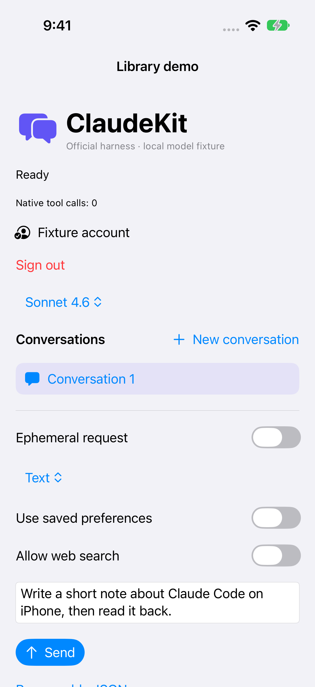
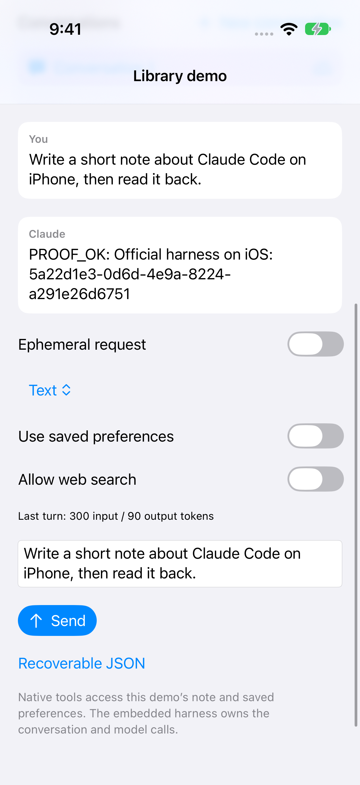

# ClaudeKit

`ClaudeKit` is a Swift SDK for building Claude-powered agents in **iOS 18+ and macOS 14+** apps. It provides Claude account sign-in, persistent conversations, streaming responses, host-defined tools, and optional local memory.

Your app owns the tools and user interface. The official Claude Code harness handles authentication, model requests, tool iteration, and conversation context. On iOS, the harness runs inside the app through embedded NodeMobile; macOS development uses an explicitly configured Node executable.

ClaudeKit is a **development alpha**. Start with the [demo app](LibraryDemo/README.md) or [SDK integration guide](docs/sdk-integration.md). See [verification](docs/verification.md) for tested behavior and remaining qualification.

## Capabilities

- Claude account sign-in through the official browser flow.
- Persistent conversations with streaming replies, cancellation, and independent concurrent turns.
- App-defined tools with native approval prompts and configurable execution limits.
- Typed text, JSON, JSON Lines, and XML output, plus durable structured recovery.
- Local memory and optional SQLite or Realm persistence.
- Model discovery, usage reporting, and opt-in hosted search.
- Remote execution and Apple integration helpers.

See the [feature matrix](docs/feature-parity.md) for supported behavior and platform limits. Image generation is excluded.

## Demo gallery

<table>
  <tr>
    <td align="center"><a href="docs/images/demo/01-sign-in.png"></a><br>Sign in</td>
    <td align="center"><a href="docs/images/demo/02-conversation.png"></a><br>Conversation</td>
    <td align="center"><a href="docs/images/demo/03-tool-approval.png"></a><br>Tool approval</td>
    <td align="center"><a href="docs/images/demo/04-completed-reply.png"></a><br>Completed reply</td>
    <td align="center"><a href="docs/images/demo/05-output-controls.png"></a><br>Output controls</td>
    <td align="center"><a href="docs/images/demo/06-reply-formats.png"></a><br>Reply formats</td>
  </tr>
</table>

Captured on an iPhone 17 Pro simulator running iOS 27.0 on 23 October 2026. Conversation, approval, reply, and format screens use the local model fixture with the real embedded harness. No live account or model responses are shown.

See [capture details and reproduction](docs/images/demo/README.md) and the [demo walkthrough](LibraryDemo/README.md).

## Documentation

Start with the [documentation index](docs/index.md) or [SDK integration guide](docs/sdk-integration.md).

| Integrate | Build features | Operate |
| --- | --- | --- |
| [Account authentication](docs/authentication.md) | [Memory](docs/memory.md) | [Troubleshooting](docs/troubleshooting.md) |
| [Messaging and concurrency](docs/messaging.md) | [Persistence](docs/persistence.md) | [Verification](docs/verification.md) |
| [Tools and policies](docs/tools-and-policies.md) | [Typed streaming output](docs/streaming-output.md) | [Migration](docs/migration.md) |
| [Apple integrations](docs/apple-integrations.md) | [Structured recovery](docs/structured-request-recovery.md) | [Architecture](docs/runtime-architecture.md) |
| [Models and usage](docs/models-and-usage.md) | [Remote execution](docs/remote-execution.md) | [Capability comparison](docs/feature-parity.md) |

Harness releases are tracked by the [automatic update process](docs/harness-updates.md), with compatibility checks and tested draft update PRs.

## Run the demo

Clone the repository, then bootstrap the pinned runtime dependencies:

```sh
git clone https://github.com/timazed/ClaudeKit.git
cd ClaudeKit
bash Scripts/bootstrap-library.sh
open LibraryDemo/LibraryDemo.xcodeproj
```

Choose the **LibraryDemo** scheme and an arm64 iPhone or simulator. For a physical device, select your development team in Signing & Capabilities. Run, tap **Sign in with Claude**, create a conversation, and send the prefilled note request. Approve the native write and read to see a complete tool loop. No API key is required for account mode.

For a deterministic test without signing in, add `--fixture` to the scheme's launch arguments. This runs the same official harness against a local model fixture; it does not contact a real model. See [demo instructions](LibraryDemo/README.md) for automated verification.

## App integration products

| Product | Purpose |
| --- | --- |
| `ClaudeKit` | Complete SDK: runtime, default harness, threads, execution handles, events, tools, approvals, persistence |
| `ClaudeKitSQLite` | Transactional rows, lazy history activation and indexed queries |
| `ClaudeKitRealm` | Realm-backed rows, lazy history activation and indexed queries |
| `ClaudeKitUI` | Sign-in coordinator/browser, approval inbox, observable runtime store |

The new products target iOS 18+ and macOS 14+. iOS embeds NodeMobile in the app process; the macOS development transport requires an explicit local Node executable. The binary currently includes arm64 device and arm64 simulator slices. Run bootstrap **before** resolving the local package in Xcode.

## Application API

Create one runtime for the app's lifetime. ClaudeKit creates and retains the official harness driver automatically, using Claude-account authentication by default. This setup belongs on the main actor because the UI presenters are main-actor objects:

```swift
import ClaudeKit
import ClaudeKitUI

let approvals = ApprovalInbox()
let signIn = ClaudeSignInCoordinator()
let runtime = try AgentRuntime(configuration: .init(
    approvalPresenter: approvals,
    stateStore: FileRuntimeStateStore(),
    signInPresenter: signIn,
    baseInstructions: "Be helpful and concise."
))

try await runtime.restore()
if await runtime.currentSession() == nil {
    try await runtime.signIn()
}

let thread = try await runtime.createThread(title: "First conversation")
let execution = try await runtime.start(Request(text: "Hello!"), in: thread.id)
for try await event in execution.events {
    if case let .assistantMessageDelta(_, _, delta) = event {
        print(delta, terminator: "")
    }
}
```

Embed `ClaudeSignInBrowser` for the coordinator's `page`, and render `approvals.pending` with approve/deny actions. The [demo view](LibraryDemo/Sources/LibraryDemoApp.swift) includes the private authentication browser and approval panel. These presenters require app UI; calling `signIn()` alone does not present a screen. Connect `coordinator.onCancel` to cancel the task awaiting `runtime.signIn()`, and pass the browser's `onCancel` to `coordinator.cancel(browserPageID:)` using that page's ID.

The browser uses `ASWebAuthenticationSession` with ephemeral browsing enabled. Cancelling closes that browser and ends the pending harness login; completing login also disposes of the browser session. The demo uses the harness's automatic loopback callback rather than a browser-to-manual-code fallback, so closing the browser always means cancellation. The low-level code submission API remains available to custom presenters. Private browsing does not clear existing Safari cookies or revoke an already completed harness login; `runtime.signOut()` separately removes the harness login.

Use `execution.cancel()` to interrupt that execution, `waitUntilReady()` to await harness readiness, or `runtime.send(_:in:)` to collect a final reply. Consume each execution's event stream once. `runtime.observeState()` supplies snapshots; `AgentRuntimeStore` exposes them to SwiftUI.

Import `ClaudeKit` to access the default-harness initializer. Importing the module does not start the harness; call `runtime.restore()` explicitly. Advanced callers can supply its optional `harness:` settings for a custom storage directory, fixture mode, or a macOS Node executable. The existing `driver:` initializer remains available for custom drivers and tests; normal apps do not need it.

## Native tools

```swift
try await runtime.registerTool(
    ToolDefinition(
        name: "read_note",
        description: "Read the app's demo note.",
        inputSchema: .object([
            "type": .string("object"),
            "properties": .object([:]),
            "additionalProperties": .bool(false)
        ]),
        approvalPolicy: .requiresApproval
    ),
    executor: AnyToolExecutor { invocation, _ in
        .success(invocation: invocation, text: "A note supplied by the app.")
    }
)
```

Tools are exposed through the harness's SDK MCP bridge. A denied approval prevents the Swift executor from running. Inputs share the typed-output JSON Schema validator and require an object root. Unsupported assertions fail registration; see [tools and policies](docs/tools-and-policies.md). Arguments and text tool results are bounded at 4 MiB; tool results allow up to 256 content blocks. Executors should cooperate with task cancellation; cancellation cannot undo a side effect that already happened.

## Sessions and authentication

One embedded Node host lives for the iOS process. A fresh Worker isolate loads the unmodified harness for each turn. The library resumes the selected official session, waits for the final assistant message to appear in the harness transcript, then commits the app-facing result for that execution. `AgentRuntime` supports simultaneous independent conversations, with one active operation per conversation. Each execution owns an independent harness session and cancellation state; there is no fixed lane assignment or library-imposed turn count. The concurrent path has not been device-qualified.

The official harness performs account login and manages its credential files. The library exposes account metadata, not account tokens. Harness configuration lives under Application Support, has iOS file protection, and is excluded from backup. App conversation projections are separate from official transcripts; preserve both for restart recovery. Use a separate driver directory and state store for each authentication mode/account. Account identity checks in this alpha use the metadata the harness supplies, not a complete account-management system.

`disconnect()` closes the active session but preserves login. `signOut()` invokes the official harness’s `auth logout` command in an isolated worker. Existing conversation projections remain bound to their original account; choose separate stores and harness directories to switch accounts. API-key credentials remain the host app’s responsibility. Token refresh is delegated to the harness but has not been tested across real expiry in this library build.

## Implementation and verification status

The library's automated checks cover independent A → B → A conversations, app restart recovery, native tools, denial, cancellation, and stale execution handles. [Evidence and exact test scope](docs/verification.md) distinguish local-fixture checks from live account checks. The original [Harness Lab](HarnessDemo/README.md) retains the earlier physical-device evidence for real Claude-account inference.

The non-image expansion now includes typed JSON/JSONL/XML/text output, recovery receipts and retry policies, tool sequences/round budgets, hosted search restrictions, advanced memory, indexed SQLite/Realm stores, import/export/migration, steering, richer usage, per-conversation concurrency, remote jobs/APNs, and Apple integration helpers. The demo exposes formats, memory/search, steering, usage, and recoverable JSON. See the [feature matrix](docs/feature-parity.md), [remote service setup](RemoteServer/README.md), and [Apple integration examples](Examples/AppleIntegrations/README.md).

The expansion has been built and tested on macOS and iOS Simulator, with a device-target compile. See [verification results](docs/verification-pending.md) for exact coverage and remaining deployment qualification. Realm 20.0.5 is resolved and tested. No build has been installed on a physical phone in this pass. Image generation is excluded.

This remains a development alpha. Backend differences include live-only hosted search, end-of-answer document decoding for JSONL/XML when tools are enabled, tool-free recovery/remote jobs, and finite local iOS background time. The feature matrix lists these explicitly rather than claiming identical behavior to CodexKit.

The pinned combination is Claude Code **2.1.112**, NodeMobile **18.19.1**, and ICU **73.2**, running without JIT. Bootstrap and startup verify the official `cli.js` checksum; the CLI itself is not patched. See [third-party provenance](HarnessDemo/ThirdParty/README.md) for hashes, sources, and license boundaries. Bundled notices also ship in the library's runtime resources.

The [implementation plan](docs/plans/claudekit-harness-library.md) records the wider roadmap. Both `DemoApp/AssistantRuntimeDemoApp.xcodeproj` and `LibraryDemo/LibraryDemo.xcodeproj` now build the same harness-backed demo sources. The existing DemoApp scheme and bundle identifier are preserved so rebuilding replaces its old API-key UI.

The [concurrency and limitations audit](docs/concurrency-audit.md) compares the actual CodexKit implementation and records removed ceilings and remaining differences.
