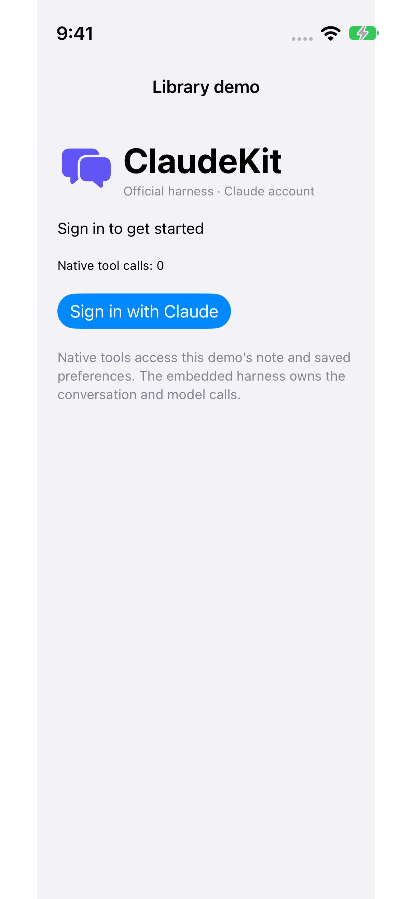
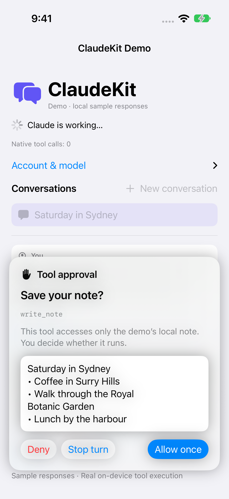
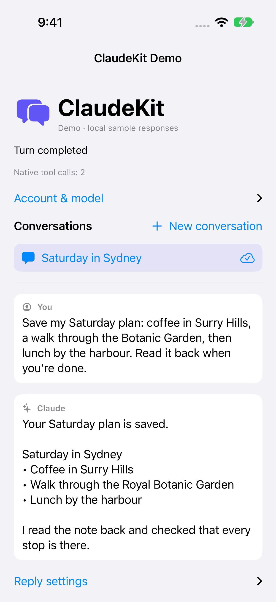
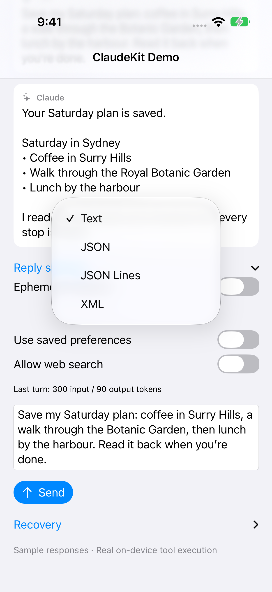
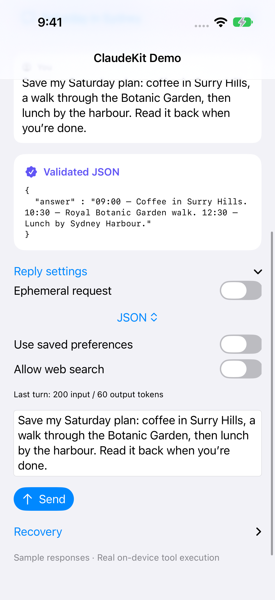

# ClaudeKit

**Build Swift apps with Claude sign-in, streaming conversations, and app-defined tools.**

ClaudeKit runs the Claude Code agent loop inside your iOS app. The harness sends model requests to Claude, and your Swift code controls the interface, conversation storage, and tools the user can approve.

**iOS 18+ · macOS 14+ · Swift tools 6.0 · Development alpha**

[Build your first SwiftUI assistant](docs/swiftui-assistant.md)

## Installation

Clone the repository and prepare the local Swift package before adding it in Xcode. Bootstrap requires Python 3, Node, npm, and Xcode. Use the Node version in `.nvmrc` for desktop development.

```sh
git clone https://github.com/timazed/ClaudeKit.git
cd ClaudeKit
bash Scripts/bootstrap-library.sh
```

In Xcode, choose **File → Add Package Dependencies → Add Local** and select the checkout.

| Product | Purpose |
| --- | --- |
| `ClaudeKit` | Complete SDK: runtime, default harness, threads, execution handles, events, tools, approvals, persistence |
| `ClaudeKitSQLite` | Transactional rows, lazy history activation and indexed queries |
| `ClaudeKitRealm` | Realm-backed rows, lazy history activation and indexed queries |
| `ClaudeKitUI` | Sign-in coordinator/browser, approval inbox, observable runtime store |

The embedded host supports arm64 iPhones and arm64 simulators. On macOS, supply the path to the Node executable in your harness configuration. [SDK integration](docs/sdk-integration.md)

## Quickstart

Open `LibraryDemo/LibraryDemo.xcodeproj`, choose **LibraryDemo**, and run on an arm64 iPhone simulator. Add `--fixture` to the scheme’s launch arguments for a first run with deterministic local responses. Create a conversation, send the prefilled note request, and approve the write and read. The reply should include the note your Swift tool saved.

For account-backed chat, remove the fixture argument and choose **Sign in with Claude**. The harness manages the browser callback and credentials. [SwiftUI walkthrough](docs/swiftui-assistant.md) · [Account setup](docs/authentication.md)

## Capabilities

| Build | Guide |
| --- | --- |
| Stream a reply, cancel a turn, and switch conversations | [Messaging](docs/messaging.md) |
| Register app tools and ask for permission before acting | [Tools and policies](docs/tools-and-policies.md) |
| Decode typed JSON, JSON Lines, and XML | [Streaming output](docs/streaming-output.md) |
| Save conversation history and retrieve user preferences | [Persistence](docs/persistence.md) · [Memory](docs/memory.md) |
| Recover structured requests after interruption | [Structured recovery](docs/structured-request-recovery.md) |
| Submit remote jobs and handle background completion | [Remote execution](docs/remote-execution.md) · [Apple integrations](docs/apple-integrations.md) |

## Demo gallery

<table>
  <tr>
    <td align="center"><a href="docs/images/demo/01-sign-in.png"></a><br>Welcome</td>
    <td align="center"><a href="docs/images/demo/03-tool-approval.png"></a><br>Approve a tool</td>
    <td align="center"><a href="docs/images/demo/04-completed-reply.png"></a><br>Saved plan</td>
    <td align="center"><a href="docs/images/demo/06-reply-formats.png"></a><br>Reply formats</td>
    <td align="center"><a href="docs/images/demo/07-structured-result.png"></a><br>Validated JSON</td>
  </tr>
</table>

Plan a Saturday in Sydney, review a native note tool, and receive a validated JSON itinerary. Captured on an iPhone 17 Pro simulator running iOS 27.0 on 24 October 2026. The demo uses labelled local sample responses with the real embedded harness and native tools.

See [capture details and reproduction](docs/images/demo/README.md) and [the demo walkthrough](LibraryDemo/README.md).

## Documentation

The [documentation index](docs/index.md) covers integration and feature guides. See the [feature matrix](docs/feature-parity.md) for platform limits and [verification](docs/verification.md) for the scope of fixture and live-account evidence.

ClaudeKit adapts Claude Code **2.1.330** for the embedded NodeMobile **18.19.1** host. Bootstrap verifies the official native archive, extracts its module graph, and converts it for Node. The iOS adaptation includes a version-specific Node compatibility change. [Harness updates](docs/harness-updates.md) · [Third-party provenance](HarnessDemo/ThirdParty/README.md)
