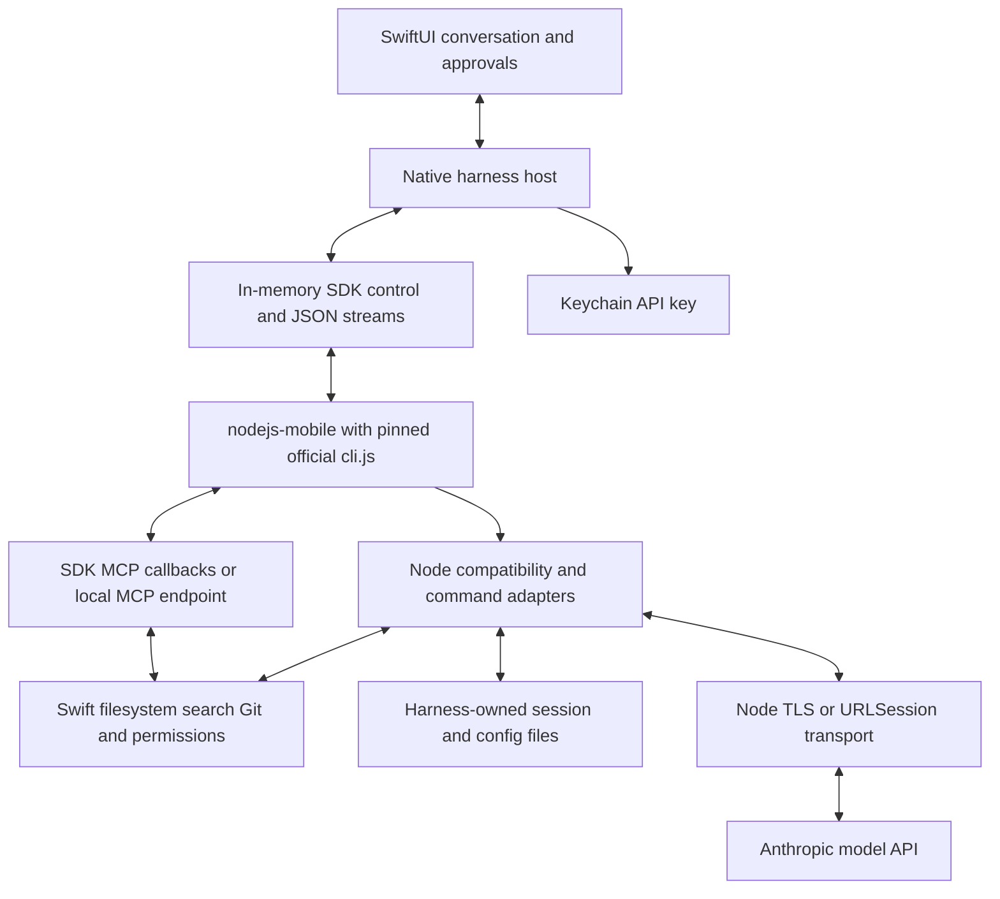

# Running the official Claude Code harness inside an iOS app

Investigation date: 14 October 2026, Australia/Sydney.

## Latest-harness prototype result, 23 October 2026

The subsequent [isolated prototype](../../Prototypes/LatestHarness/README.md) passed a physical-iPhone fixture tool loop with the current 2.1.308 harness, then resumed the same session in a new process without repeating tools. It reconstructed the Bun module graph, converted modules to CommonJS, added host adapters/polyfills, and made an explicitly recorded iOS-only exception to the Node 22 version guard. It is an adapted prototype, not an unmodified or fully qualified distribution. Shipping runtime resources and the production pin were not changed. See the [device report](../../Prototypes/LatestHarness/Evidence/iphone-tool-loop.json) and [restart/resume report](../../Prototypes/LatestHarness/Evidence/iphone-resume.json).

## Follow-up: latest release investigation, 23 October 2026

**The native packaging change does not prove that the latest harness cannot be ported to an on-device JavaScript host.** Directly executing the desktop binary on iOS remains unavailable through our current integration, but extraction of its embedded JavaScript is a concrete experimental route. This qualifies the earlier conclusion below; it does not establish a working current-version iOS port.

I inspected the official `claude-code` 2.1.308 and `claude-agent-sdk` 0.3.308 archives. Both distribute native platform executables, with no iOS package in their optional dependency lists. The SDK's `/core` export is a smaller client wrapper, not a separately distributed portable agent engine. Its `extractFromBunfs` helper extracts an embedded executable to disk so it can be spawned, not the harness JavaScript for in-process execution. [CLI metadata](https://registry.npmjs.org/@anthropic-ai/claude-code/2.1.308), [SDK metadata](https://registry.npmjs.org/@anthropic-ai/claude-agent-sdk/0.3.308).

### What was directly verified

The official macOS ARM64 2.1.308 binary was downloaded and checked against npm's SHA-512 integrity value. It is a 274,675,680-byte Mach-O executable targeting macOS 13.0+, with a 180,711,037-byte `__BUN,__bun` section. Static scanning recovered 2,524 JavaScript source chunks totaling 48,607,258 UTF-8 bytes. **All 2,524 chunks passed syntax-only parsing in Node 24.14.0.** No module was linked or evaluated. This establishes recoverable JavaScript syntax, not executable completeness, correct module identities, Node 18 support, or working behavior on iOS. [Machine-readable evidence](claude-code-ios-latest-2026-10-23.json).

The source references Bun-specific facilities, including `bun:jsc`, `Bun.file`, `Bun.spawn`, `Bun.SQL`, `Bun.Terminal`, `Bun.FetchSession`, and zstd decompression. These are literal occurrence findings, not proof that each facility is required by the headless path. The package also contains runtime/native assets; extracting JavaScript alone does not resolve those dependencies. Bun documents that compiled executables bundle the application and runtime, and that bytecode compilation does not obscure source. [Bun executable documentation](https://bun.com/docs/bundler/executables).

### Candidate approaches

| Approach | Assessment |
| --- | --- |
| Extract current modules and host them in nodejs-mobile | Best focused experiment for this repository. Reuses the existing iOS host, native tool bridge and lifecycle work. Requires a proper Bun module-table/asset extractor and implementations of the runtime behavior actually reached by the headless harness. Not yet proven. |
| Use the current Agent SDK directly | Does not remove the native harness process dependency. Neither `/core`, `/browser`, nor the extraction helper is evidence of an in-process iOS agent engine. |
| Use swift-bun/JavaScriptCore | Another experimental host, but its documented missing Worker, TLS/HTTP2 and native-addon support would introduce additional work. It does not directly load the official desktop executable. |
| Run the Linux executable inside an on-device emulator | Technically plausible way to preserve the official executable. UTM SE offers interpreted emulation without JIT, but guest OS overhead, startup, memory and latency need measurement. No successful Claude 2.1.308 run in UTM was established here. This is a fallback research route, not a lightweight SDK solution. |
| Obtain a portable official build | The most maintainable route, but no public current iOS or in-process harness distribution was found. |

There is useful precedent: [claude-code-qnx](https://github.com/qnx/claude-code-qnx) extracts Claude Code's bundled JavaScript and supplies Node-based Bun adapters. However, its inspected extractor looks for a single `src/entrypoints/cli.js` marker that is absent from the 2.1.308 macOS binary. Its launcher also returns empty modules for unresolved Bun filesystem assets, and its adapter includes approximations/stubs. These are reasons to study the technique rather than adopt it unchanged or assume every update works.

[L Shell](https://github.com/ikunluo3-bit/l-shell-ios) still explicitly pins 2.1.112. [swift-bun](https://github.com/1amageek/swift-bun) describes an experimental compatibility subset. [UTM's documentation](https://github.com/utmapp/UTM) explains the JIT versus interpreted-emulation tradeoff. None establishes a current-version production iOS harness.

### Recommended next experiment

Build an isolated extraction/hosting prototype from the checksum-verified current package, preserving source bytes and asset identities wherever possible. First reconstruct and resolve the full module graph. Then trace missing APIs under desktop Node with JIT disabled and without credentials. Implement the required Bun behavior accurately; unsupported features should fail explicitly rather than return fake success. The current Node 24 syntax result must also be repeated against the embedded Node 18 runtime.

The first meaningful acceptance gate is the current harness emitting its initialization response and completing the existing local fixture turn with two native tools, approvals and session resume. Repeat that on an actual iPhone, then measure cold start, memory, cancellation and multiworker behavior. Only a successful device fixture run justifies changing the production pin or update workflow. A subsequent live-account test is separate.

Keep the scheduled updater blocked for native packages until this path is qualified. If successful, extend it to extract and validate each new release's module graph and run the same device acceptance gates. No current-version modules, downloaded native binaries or third-party shim code were added to the shipping runtime during this investigation.

## Executive conclusion

**Follow-up experiment, 14 October 2026:** after the investigation, an explicitly authorized standalone [Harness Lab demo](/Users/tima/Projects/AssistantAI/ClaudeKit/HarnessDemo/README.md) ran the unmodified `2.1.112` harness inside a development-signed app on a physical iPhone 16 Pro Max (iOS 27.0.1). It passed initialization, streaming against a local model fixture, two native Swift MCP tool calls, permission control, and session resumption across an app restart. The Node runtime and Swift host reported the same process ID, with JIT disabled. A Node build with ICU and writable iOS cache paths were required. [Tool-loop evidence](/Users/tima/Projects/AssistantAI/ClaudeKit/HarnessDemo/Evidence/iphone-tool-loop.json), [resume evidence](/Users/tima/Projects/AssistantAI/ClaudeKit/HarnessDemo/Evidence/iphone-resume.json).

**Claude-account test, 15 October 2026:** the user completed the harness's own browser login on that iPhone and a real Claude Sonnet 4.6 turn succeeded: one native Swift write, one read, two manual approvals, 124 streaming events, and a persisted official transcript. Account mode supplied no API key and made zero fixture requests. [Live account evidence](/Users/tima/Projects/AssistantAI/ClaudeKit/HarnessDemo/Evidence/iphone-account-tool-loop.json). This establishes the tested historical subset, including real account inference; subagents, compaction, unrestricted shell execution, and distribution eligibility remain unverified.

A subsequent device UI test restored the account without browser interaction, resumed the same conversation in a new process, and recalled the exact prior note with zero tool calls. Installation had relocated the iOS container, exposing a cwd-based transcript lookup failure; resolving the saved JSONL within the app's config directory and passing it to the official resume interface fixed this without editing the harness or transcript. [Live resume evidence](/Users/tima/Projects/AssistantAI/ClaudeKit/HarnessDemo/Evidence/iphone-account-resume.json).

**A restricted, local iOS experiment using an older official JavaScript harness is technically credible. Embedding the current official distribution through ordinary JavaScript shims is not presently an available integration path.** These are different propositions, and the distinction determines whether this project can stay current.

The decisive packaging change is directly verifiable: `@anthropic-ai/claude-code@2.1.112` contains a 13,711,684-byte `cli.js`; `2.1.113` replaces that entry point with a native executable wrapper. The inspected current release, `2.1.299`, remains on the native path. Its macOS ARM64 executable is a macOS Mach-O program with Bun sections, not an iOS library. An ARM64 CPU match does not make that program loadable into an iPhone app. [Historical package](https://registry.npmjs.org/@anthropic-ai/claude-code/2.1.112), [transition package](https://registry.npmjs.org/@anthropic-ai/claude-code/2.1.113), [current package](https://registry.npmjs.org/@anthropic-ai/claude-code/2.1.299).

The Agent SDK does preserve the official loop, but its normal execution backend launches the harness. Replacing its transport can connect to a harness you have already made runnable; it does not turn the SDK wrapper into that harness. The current package has no published iOS executable or callable in-process agent-engine entry point. [Official loop architecture](https://code.claude.com/docs/en/agent-sdk/agent-loop), [SDK package](https://registry.npmjs.org/@anthropic-ai/claude-agent-sdk/0.3.299).

The closest achievable architecture is therefore a **pinned historical official bundle inside nodejs-mobile, with an in-process transport, runtime shims, and native tools**. A JavaScriptCore host is a second experimental route. Public projects supply concrete implementation evidence for both approaches, but their claims do not establish current-version compatibility, full feature parity, or App Store approval.

For a maintained product, the preferred route is an Anthropic-provided portable harness or iOS library, with permission to package it and a supported host interface. Without that cooperation, keeping a historical bundle unchanged is possible in principle, but keeping the official harness continuously updated without substantial compatibility work is not a defensible promise.

The initial investigation below performed static package and source inspection. The subsequent implementation experiment is recorded separately in the follow-up above. The original evidence inventory and hashes are saved in [claude-code-ios-evidence.json](/Users/tima/Projects/AssistantAI/ClaudeKit/docs/investigations/claude-code-ios-evidence.json).

## What is actually distributed

### Public repositories and implementation language

The inspected `anthropics/claude-code` tree at commit `9b4f0d6ef8ceaf62f6b46babb9a4d84bec541a2e` contains documentation, examples, plugins, mods, scripts, and project infrastructure. It does not contain the complete harness source tree or a buildable agent-engine library. The repository being public does not make the harness open source. [Pinned repository](https://github.com/anthropics/claude-code/tree/9b4f0d6ef8ceaf62f6b46babb9a4d84bec541a2e).

The execution-layer language is JavaScript. Historical distributions expose a bundled, minified ES module; TypeScript source paths survive in that bundle, and the SDK ships TypeScript declarations and references to its TypeScript implementation. That supports TypeScript origins, but the private source cannot be audited language by language. Current native packaging combines JavaScript application code with Bun's native runtime and native dependencies. Bun explicitly identifies Claude Code as a Bun executable. Calling the entire implementation either “plain JavaScript” or “a native rewrite” would be misleading. [Bun's distribution description](https://bun.com/blog/bun-joins-anthropic), [historical archive](https://registry.npmjs.org/@anthropic-ai/claude-code/-/claude-code-2.1.112.tgz).

| Artifact inspected | Actual contents and boundary | iOS consequence |
|---|---|---|
| Claude Code `2.1.112` | `type: module`, `bin.claude: cli.js`, Node `>=18`; bundled JS, desktop ripgrep executables, audio `.node` modules, Linux seccomp helpers; optional platform-specific sharp packages | A JavaScript engine can attempt to load it, but runtime and native-tool dependencies still need adaptation |
| Claude Code `2.1.113` | `bin.claude: bin/claude.exe`; `cli-wrapper.cjs` and installer select native packages | The npm route no longer provides the old JavaScript harness entry point |
| Claude Code `2.1.299` | Small wrapper package; optional Linux, macOS and Windows architecture packages; npm metadata says Node `>=22` | Node is relevant to the installer/fallback wrapper, not a prerequisite for running the installed native executable |
| macOS ARM64 `2.1.299` | 247,931,696-byte `MH_EXECUTE`; `LC_BUILD_VERSION` platform 1, minimum macOS 13; `__BUN` and `__bun_builtins` sections | Not an iOS framework or an executable accepted by an ordinary iOS app host |
| Agent SDK `0.2.112` | `sdk.mjs`, declarations, bundled `cli.js`, `claudeCodeVersion: 2.1.112` | A useful historical pairing for an embedding experiment; its CLI build has a different hash from the CLI package, so pin the chosen artifact explicitly |
| Agent SDK `0.3.299` | JS wrappers and declarations plus optional native platform packages | Wrappers can be portable without the actual harness being portable |
| Python Agent SDK | Public Python client, control protocol and transport implementation; bundled CLI in platform wheels | Porting Python does not remove the executable dependency |

These observations come from the actual npm archives and metadata, not npm search descriptions: [CLI current](https://registry.npmjs.org/@anthropic-ai/claude-code/2.1.299), [SDK historical](https://registry.npmjs.org/@anthropic-ai/claude-agent-sdk/0.2.112), [SDK current](https://registry.npmjs.org/@anthropic-ai/claude-agent-sdk/0.3.299), [native platform package](https://registry.npmjs.org/@anthropic-ai/claude-code-darwin-arm64/2.1.299), [Python SDK](https://github.com/anthropics/claude-agent-sdk-python).

Official installation documentation recommends native installation; the repository marks npm installation deprecated. Supported desktop operating systems, shell requirements and a 4 GB system-RAM recommendation are not an iOS support statement. That RAM recommendation also must not be mistaken for a measured harness working set. [Installation and requirements](https://code.claude.com/docs/en/setup).

### CLI coupling and independent invocation

Headless operation is real: `-p`, streamed JSON input/output, session resumption and permissions make the interactive terminal UI unnecessary for an embedded product. They do not eliminate the process-shaped runtime. The old `cli.js` initializes itself and calls its main path on evaluation; it does not export a documented `AgentEngine` with injected filesystem and network services. Configuration, environment, streams, module loading and cleanup remain part of startup. [CLI reference](https://code.claude.com/docs/en/cli-reference), [historical CLI archive](https://registry.npmjs.org/@anthropic-ai/claude-code/-/claude-code-2.1.112.tgz).

Thus the practical historical approach hosts a CLI-shaped program inside one application process. It supplies virtual standard streams and process lifecycle semantics around the original loop. This is more work than importing an npm library, but it need not involve rewriting the loop.

### Exports whose names can mislead

Inspection of the SDK packages resolves several plausible shortcuts:

- Current `/core` is a smaller SDK wrapper with external peer dependencies. It still uses the execution backend.
- Current `/browser` requires a WebSocket or SSE session connection. It is a client for an existing harness session, not a browser-resident loop.
- `/bridge` handles session connectivity and control traffic.
- Current `/extract` copies an embedded native executable to a real filesystem path. It does not extract a portable JavaScript harness.
- Historical `/embed` embeds `cli.js` as an asset and extracts it so a child process can launch it. Historical `/assistant` orchestrates SDK queries and bridge sessions.

None of these exports establishes an iOS engine API. Sources: `README.md`, `core.d.ts`, `browser-sdk.d.ts`, `bridge.d.ts` and `extractFromBunfs.js` in the [current SDK archive](https://registry.npmjs.org/@anthropic-ai/claude-agent-sdk/-/claude-agent-sdk-0.3.299.tgz); `embed.js` and `assistant.d.ts` in the [historical SDK archive](https://registry.npmjs.org/@anthropic-ai/claude-agent-sdk/-/claude-agent-sdk-0.2.112.tgz).

## Runtime dependency map

The matrix distinguishes **observed API presence** from **proven necessity**. The JavaScript inspection is of `2.1.112`; current SDK interfaces and official documentation add evidence about current behavior. A string or import in bundled third-party code does not prove that a minimal conversation executes it. No claim is made that this is a complete call graph of the current native binary.

Difficulty is an engineering judgment: low means a contained adapter; medium means substantial semantic tests; high means a runtime subsystem or several interacting compatibility layers.

| Dependency | Actual usage or evidence | Required for core harness? | iOS replacement | Difficulty |
|---|---|---|---|---|
| Module loading and JS globals | ESM imports; `node:module`/`createRequire`; CommonJS dependencies inside the bundle; Buffer, URL, streams | Yes, at initialization | nodejs-mobile's loaders; or a complete loader/transform plus globals in JSC | High for JSC; medium for embedded Node |
| Filesystem | `fs`, `fs/promises`, synchronous reads/stats and writes; configuration, workspace and transcript paths | Yes for normal boot and requested persistence, beyond just Read/Write tools | Sandboxed POSIX access or FileManager-backed Node API; real `Stats`, error codes, descriptors and rename behavior | High |
| Path, OS and environment | `path`, `os`, process environment, working directory, platform and home discovery | Yes | App-owned HOME/workspace; explicit environment; consistent platform policy | Medium |
| Standard streams | CLI JSON input/output plus diagnostics, backpressure, EOF and cancellation | Yes for the CLI/SDK boundary | In-memory streams or pipes connected to a Swift actor | Medium–high |
| Process creation | `child_process`, `spawn`, `spawnSync`, `execFile`; SDK launches CLI; tools and helpers launch commands | Normal distribution uses it; arbitrary OS processes are not conceptually necessary for the loop | In-process harness host and command dispatch; reject unsupported execution | High; no transparent general replacement |
| Shell | Bash tool, shell discovery, command wrappers and environment setup | Optional as a model tool; shell-related startup probes can remain | Restricted parser and command registry, or disable Bash and offer explicit native tools | High |
| HTTP and TLS | `http`, `https`, `tls`, `net`, fetch/stream machinery and bundled HTTP parser code | Yes for model calls | Embedded Node networking or URLSession bridge preserving streamed bytes, aborts, headers and errors | High |
| WebSockets and SSE | SDK browser/bridge transports and MCP transports; model token streaming uses HTTP streaming | HTTP streaming yes; WebSockets depend on selected features | URLSession streaming/WebSocket APIs or runtime equivalents | Medium–high |
| Cryptography | `crypto` hashing/randomness; TLS and authentication dependencies | Yes for secure operation; exact algorithms depend on features | Node/OpenSSL or CryptoKit/Security adapters; cryptographic randomness | Medium–high |
| Timers and event loop | Timers, `timers/promises`, EventEmitter, async hooks, task cancellation and stream scheduling | Yes | libuv in nodejs-mobile; or dedicated JSC queue plus host scheduler and microtask handling | High |
| Worker threads | `worker_threads`, MessagePort-related bundled code and worker references occur in legacy JS | Presence verified; necessity for minimal headless loop unproven | Runtime-supported workers or a narrowly validated no-worker path | High if exercised |
| Engine-specific utilities | Legacy `v8`, `vm`, `inspector` and diagnostics imports; conditional Bun heap diagnostics | Core necessity not established by static inspection | Real runtime equivalents where used; feature-gated diagnostics can be omitted only after checking failure behavior | Medium for diagnostics; high for actual VM/context dependence |
| Native addons | Optional sharp/image code; shipped audio capture `.node` files | Not all needed for text-only operation | Disable optional features through supported configuration, or compile iOS libraries and bridge them | High; desktop `.node` files are unusable as-is |
| WebAssembly | Legacy bundle contains compile/instantiate calls in HTTP parser machinery | Can be reached by network/runtime code; not just optional tools | WASM-free networking, a compatible interpreter, or genuine native equivalent | High; an empty WASM shim is not implementation |
| Bun-specific APIs | Legacy conditional `Bun.hash`, `Bun.spawn`, `bun:jsc`; current executable embeds Bun | Bun is not mandatory for the legacy Node-targeted package; current artifact contains its own runtime | Prefer legacy Node paths; port only exercised APIs if using JSC | High for a general Bun port |
| Search | Bundled ripgrep and its invocation paths; documented Grep/Glob capabilities | Tool-dependent, possibly used by internal discovery too | Embedded native search or a compatible command adapter, including glob/ignore rules and output modes | Medium–high |
| Git | Harness repository context plus model-requested shell git operations | Some coding workflows need it; a basic turn need not | libgit2 or isomorphic-git behind explicit operations/command adapters | High for broad CLI parity |
| Terminal interfaces | `tty`, `readline`, raw input and rendering dependencies | Interactive interface optional; imports/probes may still occur | Headless streams, `isTTY = false`, meaningful unsupported responses | Medium |
| Session persistence | SDK session operations; CLI transcript/config files and resume identifiers | Required for requested behavior | Preserve harness-owned files in Application Support; Swift/SQLite indexes metadata separately | Medium–high |
| Plugins, hooks, MCP and LSP | Configuration loads extensions; stdio servers/hooks/language servers may execute programs; SDK MCP can run handlers in its host | Optional extensions, not every core conversation | In-process or HTTP MCP; bundled data-only extensions; native handlers; reject subprocess-only plugins | High for broad compatibility |
| Credentials and approvals | Authentication state; SDK control requests, permission decisions and hook callbacks | Yes for authenticated, approval-aware operation | Keychain-held API key; asynchronous SwiftUI approval responses | Medium |

API-presence evidence: `cli.js` and vendored file inventory in the [2.1.112 archive](https://registry.npmjs.org/@anthropic-ai/claude-code/-/claude-code-2.1.112.tgz). Current execution/extension contracts: [SDK declarations](https://registry.npmjs.org/@anthropic-ai/claude-agent-sdk/-/claude-agent-sdk-0.3.299.tgz), [custom tools](https://code.claude.com/docs/en/agent-sdk/custom-tools), [permissions](https://code.claude.com/docs/en/agent-sdk/permissions), [sessions](https://code.claude.com/docs/en/agent-sdk/sessions). The native Git library option is supported by [libgit2's library interface](https://github.com/libgit2/libgit2).

### Transparent replacements and semantic changes

Filesystem, paths, cryptography, networking and scheduling can be transparent **only if the replacement reproduces the exercised API semantics**. They need not alter the agent algorithm. Read/Write/Edit tool names alone substantially understate filesystem needs: boot configuration and persistence also use it.

There is a concrete warning from an existing JSC implementation: a Claude Code startup failure was traced to filesystem errors missing Node's `code`, `path` and `syscall` fields. A message saying “ENOENT” was insufficient; initialization stalled before emitting the session-init event. This is evidence that matching function names without matching behavior is inadequate. [swift-bun incident report](https://github.com/1amageek/swift-bun/blob/504aa47a80fb212eaa915a9b6177cd423cba68b9/Docs/CLIInitCompatibilityIncident-2026-04-02.md).

General process creation, signals, process isolation, executable loading and complete shell semantics cannot be transparently replaced by FileManager calls. Emulating a supported command set changes the available environment. Installing a throwing stub can expose an unsupported feature accurately; returning fabricated success can silently corrupt the harness's decisions.

The current Bun binary adds a separate obstacle: the external host cannot normally intercept its embedded runtime by defining `globalThis.Bun` or replacing Node imports in a surrounding JS context. A library build, vendor host API, or substantial unsupported binary/source adaptation would be required first.

## JavaScript runtime options

No engine in this table directly consumes the current desktop Claude Code executable as an iOS agent library. “Candidate” below means a host for a separately available JavaScript harness, initially the pinned historical artifact.

| Runtime | Modules and Node/Bun compatibility | Event loop, async I/O and native modules | iOS, memory and maintenance assessment |
|---|---|---|---|
| JavaScriptCore | Executes JavaScript; public `JSContext` embedding is not Node. Supply module resolution/CommonJS and handle ESM loading or transformation; bridge globals and Node/Bun APIs | Host owns scheduling, stream integration and Swift bridges. Desktop Node addons cannot load into JSC | Native Apple framework; design for execution without app-controlled JIT. No measured harness footprint. Large semantic compatibility burden; swift-bun offers a head start |
| QuickJS | ES modules supported; CommonJS needs a loader or bundling. No Node/Bun standard library | Host drives pending jobs and I/O; C module interface differs from Node addons | Small embeddable interpreter, memory-limit and interruption APIs. Low engine size does not establish low harness memory. Extensive shims and syntax/API validation needed |
| Hermes | Mobile JS engine with compact bytecode and ahead-of-time optimization. ESM/CJS packaging must be resolved by the application build/loader; no Node/Bun host APIs | Host/JSI supplies native functions, event loop and networking; Node addons require a bridge/rewrite | Established iOS use through React Native. Bytecode/runtime versions must match. High harness-adaptation burden with little advantage over Node compatibility for this workload |
| Embedded Node through nodejs-mobile | Closest existing match to historical Node-targeted JS; ESM/CommonJS and many Node APIs are available, subject to the chosen mobile build | libuv, filesystem, sockets, TLS; one runtime instance per process is the documented model. Child-process restrictions remain; addons must be rebuilt for iOS | Best first experiment. Jitless V8 builds can lack WASM/ICU behavior expected by packages. More footprint than a small interpreter; validate memory and cleanup. Runtime fork/version maintenance remains |
| Embedded Bun | Desktop Bun provides ESM/CJS, many Node APIs and Bun APIs | Native runtime, I/O, addons and executable filesystem are interdependent | No published iOS embedding target in the inspected distribution/docs. Sharing JSC ancestry does not make Bun equivalent to `JavaScriptCore.framework`. A Bun iOS port is a major project before harness integration |
| WKWebView | Browser JS and browser module behavior; no Node filesystem/process APIs | WebKit networking and message bridge; separate web-content process and lifecycle | May execute browser-compatible code, but no evidence it hosts this harness. More bridging, storage and lifecycle constraints; SDK `/browser` still needs a running harness |
| Linux or CPU emulation | Could supply a foreign userspace in principle | Must emulate guest processes, libraries and architecture requirements | Locally executed emulation is distinct from native embedding. iSH's x86 userspace does not directly match the inspected x64/ARM64 Claude distributions. No validated current-harness path found |

Primary runtime sources: [JavaScriptCore](https://developer.apple.com/documentation/javascriptcore), [QuickJS manual](https://bellard.org/quickjs/quickjs.html), [Hermes](https://github.com/facebook/hermes), [nodejs-mobile README](https://github.com/nodejs-mobile/nodejs-mobile), [mobile API differences](https://nodejs-mobile.github.io/docs/api/differences/), [Bun executable targets](https://bun.sh/docs/bundler/executables), [iSH](https://github.com/ish-app/ish).

**JIT and WASM are separate questions.** A JS interpreter can operate without JIT. Some inspected mobile V8 builds omit WASM, but WASM interpretation is not inherently forbidden by iOS. Conversely, a JSC-based project using WASM in its module transformer must prove that exact path works in the target device build. A simulator or debugger-assisted run is insufficient evidence for a release app. Apple's security model restricts dynamically executable memory; importing JavaScriptCore does not grant unrestricted executable-memory access. [Apple runtime security](https://support.apple.com/en-au/guide/security/sec15bfe098e/web).

There is no verified complete compatibility layer for the current harness. `unenv` offers useful cross-runtime Node compatibility, but it includes mocked and unimplemented behavior; resolving imports is not a guarantee of filesystem, process or networking correctness. `swift-bun` is more directly relevant to Swift, but explicitly documents an incomplete API surface. [unenv](https://github.com/unjs/unenv), [swift-bun](https://github.com/1amageek/swift-bun).

No device memory benchmark was performed. As context only, the current SDK's `prewarm()` declaration estimates approximately 230–260 MB for a parked desktop harness process. That is neither an iOS estimate nor a peak for long conversations. Source size, installed binary size and resident memory are different measurements. [SDK declarations](https://registry.npmjs.org/@anthropic-ai/claude-agent-sdk/-/claude-agent-sdk-0.3.299.tgz).

## Tool replacement and the Agent SDK

### What the SDK does preserve

Anthropic documents the Agent SDK as exposing the same loop and context management as Claude Code. On a supported execution host, its interfaces include sessions, permissions, hooks, custom tools and subagents. Those behaviors live in or depend on the harness, so retaining that harness preserves a stronger foundation than rebuilding the loop from API calls. It does not promise identical prompts or configuration unless those are also selected consistently. [SDK overview](https://code.claude.com/docs/en/agent-sdk/overview).

The Python implementation makes the execution boundary visible: `SubprocessCLITransport` builds CLI arguments, opens a process and manages its streams and termination. Python exposes a transport abstraction. The current TypeScript `Options.spawnClaudeCodeProcess` accepts a custom backend returning a process-shaped object with input/output streams, exit/error events and termination behavior. [Python subprocess source](https://github.com/anthropics/claude-agent-sdk-python/blob/main/src/claude_agent_sdk/_internal/transport/subprocess_cli.py), [Python transport interface](https://github.com/anthropics/claude-agent-sdk-python/blob/main/src/claude_agent_sdk/_internal/transport/__init__.py), [TypeScript SDK declarations](https://registry.npmjs.org/@anthropic-ai/claude-agent-sdk/-/claude-agent-sdk-0.3.299.tgz).

An in-process virtual transport is therefore a plausible adaptation for an already-loadable historical bundle. It must emulate cancellation, EOF, stream backpressure and exit ordering. It is an inference about adapting the public transport contract, not official iOS support. A wrapper-only port without a runnable local harness fails the user's objective.

### Tool dispatch has more than one path

There is now a supported redirection mechanism worth using if a portable current harness becomes available. SDK `0.3.299` declares `toolAliases`, which maps model-emitted tool names to other registered tools, including MCP tools. For example, a native-backed MCP command could receive calls emitted under `Bash`.

The same declaration explicitly distinguishes name-based dispatch from **harness-internal direct calls that already hold a tool object**. Aliases do not intercept the latter; `disallowedTools` is complementary. This is direct evidence against assuming one universally replaceable registry captures every dependency. `toolAliases` is absent from the inspected `0.2.112` SDK declarations, so the historical proof of concept must not assume it exists. [Current declarations, `Options.toolAliases`](https://registry.npmjs.org/@anthropic-ai/claude-agent-sdk/-/claude-agent-sdk-0.3.299.tgz), [historical declarations](https://registry.npmjs.org/@anthropic-ai/claude-agent-sdk/-/claude-agent-sdk-0.2.112.tgz).

Three integration levels are available:

1. **Runtime adaptation:** keep built-in tools and implement the filesystem, search and command APIs beneath them. This preserves the most tool behavior, while requiring the most compatibility work.
2. **Custom MCP tools:** configure the tool surface and register handlers that bridge to Swift. This preserves the official loop while replacing particular capabilities. Different names, schemas or formatting can change model behavior and built-in bookkeeping.
3. **Current tool aliases:** redirect model-emitted legacy names to those MCP tools, where the selected harness supports the option. This reduces naming friction but does not eliminate runtime adaptation.

`canUseTool` is a permission callback, not a tool executor. `PreToolUse` can control permissions and update inputs; it has no general “return this result without executing the tool” contract in the inspected declarations. Current `PostToolUse.updatedToolOutput` can replace output, but it runs after execution, so it cannot prevent an unavailable syscall from occurring. [Hooks](https://code.claude.com/docs/en/agent-sdk/hooks).

`allowedTools` is an approval allowlist, not a complete capability restriction. Use the tool-selection and denial mechanisms to remove unsupported tools. Automatically permitted calls can bypass `canUseTool`; use the appropriate hook and native authorization boundary when every operation must be checked. [Permission evaluation](https://code.claude.com/docs/en/agent-sdk/permissions).

### Native adapter boundaries

| Capability | Native implementation | Compatibility requirements |
|---|---|---|
| Read / Write / Edit | FileManager/POSIX behind either Node-compatible filesystem calls or MCP handlers | Encoding, line ranges, edit matching, atomicity, error shape, symlinks and approval paths; MCP replacement may not inherit built-in checkpoints |
| Glob | Directory enumeration plus glob/ignore engine | Match hidden files, recursive patterns, ordering and result limits for the selected contract |
| Grep | Native search library or compiled search core | Regex dialect, binary files, offsets, context lines and ripgrep-style JSON where required; Foundation regex alone is not ripgrep parity |
| Restricted commands | Parser and registry invoking linked functions | Argument quoting, expansion, pipes, redirects, cwd/env, status, stderr, cancellation and output limits |
| Git | libgit2 or isomorphic-git | Explicitly enumerate supported commands; hooks, external filters, credential helpers and worktrees need separate decisions |
| HTTP | URLSession | Incremental streaming, UTF-8 chunk boundaries, aborts, TLS, redirects, proxy behavior and backpressure |
| Persistent state | Harness-owned files plus a Swift metadata index | Preserve session layout/IDs and version compatibility; SQLite is not a transparent replacement for transcript files |
| Credentials | Keychain-held user API key, exposed to the authorized runtime path | Avoid writing secrets into transcripts or general workspace configuration |
| Approvals | SwiftUI request queue keyed by control/tool IDs | Preserve pending requests, deny/cancel behavior and response ordering without blocking the UI thread |
| MCP | In-process SDK MCP bridge or native HTTP MCP transport | The in-process MCP server lives in the SDK host; the default harness still lives in another process until adapted |

These are proposed interfaces, not completed implementations. [Custom tool protocol](https://code.claude.com/docs/en/agent-sdk/custom-tools), [libgit2](https://github.com/libgit2/libgit2), [session behavior](https://code.claude.com/docs/en/agent-sdk/sessions).

## Restricted shell feasibility

A useful subset is feasible: `ls`, `cat`, `grep`, `find`, `mkdir`, `rm`, `cp`, `mv` and `pwd` can operate on an app workspace. Git can be a library-backed command family. `ios_system` already demonstrates linked commands with redirected streams, and `just-bash` supplies a JavaScript shell implementation intended for agent environments. Neither turns iOS into a general POSIX process host. [ios_system](https://github.com/holzschu/ios_system), [just-bash](https://github.com/vercel-labs/just-bash).

The work is in semantics, not the command names. Even a short shell call can contain quoting, variable expansion, command substitution, pipelines, redirection, `&&`, exit-status checks and temporary files. A simple string split will fail. Claude Code may also wrap a user command in shell setup or output-capture logic before spawning it; the adapter must handle the actual invocation, not just the visible command.

For the first experiment, disable Bash and provide explicit file/search tools. Add a restricted shell only after the official loop works. If Bash remains exposed, describe its capabilities in the tool schema and system instructions, return honest errors for unsupported constructs, and test recovery. The loop can continue after a tool error or operate with Bash unavailable; whether it completes a particular coding task is a separate question. [Tool availability](https://code.claude.com/docs/en/agent-sdk/permissions), [error handling for custom tools](https://code.claude.com/docs/en/agent-sdk/custom-tools).

Arbitrary executables, compiler toolchains, package install scripts, native build steps, daemons and general subprocess MCP servers remain unsupported unless individually embedded or otherwise implemented. A file-editing agent can be useful under these limits; a request to build and test an arbitrary repository may be impossible locally. This is capability loss, not proof that the planning/tool loop intrinsically needs unrestricted shell execution.

## Existing implementations and their evidence

| Project | What the inspected source establishes | What it does not establish |
|---|---|---|
| [nodejs-mobile](https://github.com/nodejs-mobile/nodejs-mobile) | Maintained mobile Node fork, iOS binaries, native embedding examples, documented API differences | Claude Code compatibility or availability of every desktop Node feature |
| [L Shell iOS](https://github.com/ikunluo3-bit/l-shell-ios/tree/e95055e4affc962b32b860704c4f551aaefce052) | SwiftUI/Node host plus process/fetch/TTY/WASM shims; pins official `2.1.112`; authors report on-device operation and development-signed releases | Independent verification here, current Claude Code support, full tool fidelity or store approval |
| [ClaudeStand](https://github.com/1amageek/ClaudeStand/tree/c7e782de62c27f91c6882732db32396f631d85b9) | Swift package loads `package/cli.js` using swift-bun; source includes session/stream handling and resume support | A working path for the current binary-only package; default checking of latest npm cannot manufacture missing `cli.js` |
| [swift-bun](https://github.com/1amageek/swift-bun/tree/504aa47a80fb212eaa915a9b6177cd423cba68b9) | JSC runtime, Node/Bun compatibility modules, native bridges and real CLI initialization tests | A port of upstream Bun or complete Node/Bun parity; release documentation calls it experimental |
| [a-Shell and ios_system](https://github.com/holzschu/a-shell) | Established iOS terminal/native-command architecture; useful reference for command adapters | An embedded official Claude harness or arbitrary desktop executable support |
| [iSH](https://github.com/ish-app/ish) | Real on-device Linux userspace through emulation | The requested native architecture or a demonstrated current Claude Code binary execution path |

L Shell provides particularly relevant code: `node-runtime/preload/shims/child_process.js` returns process-shaped objects and routes commands to in-process handlers. Its synchronous shell path is not fully equivalent to the asynchronous one. Its WASM shim deliberately fails WASM operations; networking is separately replaced to avoid a WASM-dependent path. This demonstrates how much runtime adaptation sits below an apparently unchanged CLI. [Process shim](https://github.com/ikunluo3-bit/l-shell-ios/blob/e95055e4affc962b32b860704c4f551aaefce052/node-runtime/preload/shims/child_process.js), [WASM shim](https://github.com/ikunluo3-bit/l-shell-ios/blob/e95055e4affc962b32b860704c4f551aaefce052/node-runtime/preload/shims/wasm-stub.js).

Its `test-agent-loop.mjs` uses a mock Anthropic backend and desktop Node with `--jitless` to exercise a real file operation through the harness. `test-ios-app.mjs` explicitly performs static checks because that CI path has no Xcode. These are meaningful tests, but neither is a recorded physical-iPhone conversation against Anthropic. The project also reports an old Node baseline, unsupported stdio MCP servers and session-related module retention. [Agent-loop test](https://github.com/ikunluo3-bit/l-shell-ios/blob/e95055e4affc962b32b860704c4f551aaefce052/test/test-agent-loop.mjs), [app test](https://github.com/ikunluo3-bit/l-shell-ios/blob/e95055e4affc962b32b860704c4f551aaefce052/test/test-ios-app.mjs), [project limitations](https://github.com/ikunluo3-bit/l-shell-ios/blob/e95055e4affc962b32b860704c4f551aaefce052/README.md).

swift-bun's separate `CLIJSTest.swift` exercises an actual cached CLI, including initialization with isolated HOME and local HTTP fixtures. Its similarly named `ClaudeBundleIntegrationTests.swift` tests a bundled Anthropic API client; that suite alone is **not** harness proof. Its documented gaps include workers, native addons and several networking surfaces. [Actual CLI tests](https://github.com/1amageek/swift-bun/blob/504aa47a80fb212eaa915a9b6177cd423cba68b9/Tests/BunRuntimeTests/CLIJSTest.swift), [API-client tests](https://github.com/1amageek/swift-bun/blob/504aa47a80fb212eaa915a9b6177cd423cba68b9/Tests/BunRuntimeTests/ClaudeBundleIntegrationTests.swift), [release scope](https://github.com/1amageek/swift-bun/blob/504aa47a80fb212eaa915a9b6177cd423cba68b9/Docs/ReleaseReadiness-0.1.0.md).

ClaudeStand's subscription-token storage and runtime package-download design should not be copied as evidence of permission to use either feature in a third-party product. Technical demonstrations do not settle licensing or distribution eligibility.

## iOS platform and distribution constraints

| Restriction | Development-signed physical iPhone | TestFlight | Public App Store |
|---|---|---|---|
| Desktop executable and process spawning | Signing your app does not convert a macOS binary into iOS code or grant general fork/exec | Same fundamental OS limitation | Same fundamental OS limitation |
| Embedded runtime | A compiled iOS runtime/library can be tested in the app process | Must also operate under distribution conditions | Runtime and app must satisfy public API and review requirements |
| JIT and generated machine code | Debugger-related behavior can differ; require a detached, no-JIT test for a product-relevant result | Do not rely on debugger privileges | Ordinary apps lack general JIT entitlement; special browser entitlements are not a general agent-host route |
| Native libraries | Build for iOS and sign/package correctly | Same; no downloaded desktop addons | Bundled signed frameworks/libraries are possible; unrestricted downloaded executable loading is not |
| Filesystem | App container and explicitly granted document access | Same | Same, plus review of app behavior |
| Downloaded JS/plugins | Technical execution can be tested, subject to OS constraints and applicable agreements | Review guidelines still apply | Runtime updates that change app functionality raise rule 2.5.2; exceptions require an actually qualifying use case |
| Background work | App lifecycle still applies | Same | Same; background modes must match their permitted purpose |
| Memory | Device-specific pressure and termination | Distribution testing essential | No guaranteed fixed per-app memory budget |

The table combines Apple's sandbox/executable-memory rules with nodejs-mobile's documented process restrictions; it is not a claim that TestFlight relaxes the OS sandbox. [Apple platform security](https://support.apple.com/en-au/guide/security/sec15bfe098e/web), [nodejs-mobile API limitations](https://nodejs-mobile.github.io/docs/api/differences/).

Apple's rules require public APIs and constrain downloaded code that changes app functionality. They include limited educational and other defined exceptions; an embedded agent cannot simply assume an exception applies. TestFlight apps are also expected to comply. The safer candidate design bundles a fixed harness/runtime and updates them through app releases. Approval still depends on the complete product. [App Review Guidelines 2.2, 2.5 and 4.7](https://developer.apple.com/app-store/review/guidelines/).

Background execution is not simply impossible. On iOS 26, `BGContinuedProcessingTask` can continue user-initiated foreground work after backgrounding, with visible progress and cancellation. The system can terminate it. The host must checkpoint at safe boundaries and recover; it cannot promise an indefinitely running agent daemon. The existing ClaudeKit package targets iOS 17, so an iOS 26 implementation would need availability handling or a raised deployment target. [Apple background-task guidance](https://developer.apple.com/documentation/backgroundtasks/performing-long-running-tasks-on-ios-and-ipados/), [task termination behavior](https://developer.apple.com/documentation/backgroundtasks/bgcontinuedprocessingtask?changes=_2).

Memory feasibility needs measurements on the lowest supported physical device: launch peak, idle footprint, long transcript, compaction peak, concurrent subagents, large tool outputs and repeated sessions. Memory pressure can terminate an app even while it is visible; simulator memory availability is not a substitute. [Apple jetsam guidance](https://developer.apple.com/documentation/xcode/identifying-high-memory-use-with-jetsam-event-reports).

## Licensing and authentication

The harness packages carry an all-rights-reserved notice and point to Anthropic's agreements. They are proprietary distributed artifacts, even where JavaScript is readable. The public Python SDK wrapper has an MIT license; that does not extend to the bundled Claude Code executable. The inspected TypeScript SDK package does not offer an MIT license for the whole harness. [CLI license](https://github.com/anthropics/claude-code/blob/main/LICENSE.md), [Python license](https://github.com/anthropics/claude-agent-sdk-python/blob/main/LICENSE), [TypeScript license](https://github.com/anthropics/claude-agent-sdk-typescript/blob/main/LICENSE.md).

Anthropic's current Claude Code product rules condition third-party inclusion on running its published binary unmodified, preserving authentication methods and direct end-user billing. That is a conditional allowance, not a general right to patch, extract, rebuild or relicense the harness. Whether an unchanged historical JS artifact under extensive host shims qualifies should be clarified with Anthropic before distribution. [Claude Code product conditions](https://code.claude.com/docs/en/legal-and-compliance).

Commercial Terms A.1 permit services to power customer products, while D.4 restricts reverse engineering/duplication and F reserves rights not expressly granted. A negotiated agreement or applicable legal exception can alter the analysis; public availability alone does not. Obtain specific rights for any source modification, binary extraction or redistribution route that is not clearly covered. [Commercial Terms](https://www.anthropic.com/legal/commercial-terms).

**Correction: hosting the unmodified official harness is distinct from building a third-party authentication client.** Anthropic's current product rules require hosted Claude Code to retain its built-in authentication methods, including Claude-account sign-in, and explicitly preserve an end user's ability to sign into that unmodified harness with their own subscription. The restriction on third-party apps collecting or intermediating Claude credentials does not justify making this experiment API-key-only. The demo now exposes the harness's own OAuth controls; it does not exchange or import subscription tokens itself. Whether packaging this historical JS artifact meets every distribution condition still requires separate assessment. [Claude Code product and authentication rules](https://code.claude.com/docs/en/legal-and-compliance), [separate Agent SDK guidance](https://code.claude.com/docs/en/agent-sdk/overview).

Legal status and engineering feasibility are separate gates. The conservative product conclusion is not “all embedding is prohibited.” It is that the proposed mobile adaptation lacks a clear supported artifact and needs a confirmed licensing basis for the exact way it packages and hosts that artifact.

## Recommended architecture and ranked alternatives

### Preferred product architecture

The smallest maintainable product would use an **official portable harness with explicit host interfaces**. Such an artifact was not found in the inspected public distributions. Ask Anthropic for either an iOS library or a supported JavaScript build with lifecycle, I/O, filesystem, tool and authentication contracts. Ordinary subagents and compaction should stay inside that component.

For a bounded historical experiment, the corresponding architecture is:

Only model inference crosses the device boundary. The app does not ask a Mac, server or container to run the loop. Swift presents messages and approvals; the original harness decides when to request the next model response, dispatch tools, compact and terminate. Host adapters return results rather than constructing a replacement agent cycle.

For the historical SDK route, a matching SDK and its `spawnClaudeCodeProcess` override can provide the control-protocol wrapper, with virtual streams connecting to the locally evaluated CLI. This keeps protocol handling close to upstream. A direct Swift JSON-stream host removes that extra JS wrapper but must implement and version the control protocol. Both depend on first proving actual harness loading.

The native workspace boundary must exist below tool selection: internal reads, shell redirects, symlinks and MCP calls must observe the same approved roots. Keep harness session files intact; store UI metadata separately. Do not replace session resumption with a Swift-maintained chat history and call that official harness persistence.

| Rank | Route | Official loop retained? | Decision |
|---|---|---|---|
| 1 for a product | Anthropic-supported portable/iOS harness plus native host | Yes, with a supported artifact | Best update and licensing story; depends on vendor cooperation |
| 1 for an experiment | Pin SDK `0.2.112`/CLI `2.1.112` with nodejs-mobile and in-process transport | Yes, for that release if loading succeeds | Closest evidence-backed local test; bounded scope and frozen capabilities |
| 2 for an experiment | Historical bundle in JSC using selected swift-bun components | Yes, if executed successfully | Swift integration is attractive; broader semantic work and more uncertain parity |
| 3 | Port upstream Bun and obtain a rebuildable official harness | Potentially | Large runtime project; still needs harness access and rights |
| 4 | Extract/patch current native artifact | Uncertain after adaptation | Unsupported, legally constrained and high maintenance; not recommended |
| Outside the objective | A custom Swift agent over the Messages API | No | Existing ClaudeKit already follows this model; useful separately, but it does not validate this hypothesis |

A remote-control client and the SDK browser transport alone fail the local-execution requirement, so neither is ranked as a solution.

### What original behavior can realistically survive

| Feature | Retention expectation | Remaining proof |
|---|---|---|
| Loop, model request construction and streamed responses | Keep the original code | Real API call and automatic continuation on device |
| Context management and compaction | Keep original implementation | Trigger compaction and continue/resume; measure peak memory |
| Tool dispatch | Keep original orchestration; adapt implementations | Success, error, parallel results, cancellation and result ordering |
| Permissions | Keep harness policy with native presentation | Allow, deny, cancellation, persistence and no bypass from configuration |
| Ordinary subagents | Potentially retain within the harness | Verify the selected implementation does not require unavailable spawn/worker paths |
| Agent teams, worktrees, terminal workers | Do not assume retained | Their process/filesystem dependencies need independent validation |
| Sessions | Preserve harness state and resumption | Relaunch the app and recover state without replaying side effects |
| Plugins/MCP | Retain compatible data and in-process/HTTP tools | Stdio servers and executable hooks remain separate blockers |

The SDK documents subagents with separate contexts and session resumption, but that is a supported-host contract, not proof of every mobile path. [Subagents](https://code.claude.com/docs/en/agent-sdk/subagents), [sessions](https://code.claude.com/docs/en/agent-sdk/sessions).

## Proof of concept plan and stop conditions

### Gate before implementation

Select the hypothesis explicitly:

- **Current release without an unsupported fork:** the inspected artifacts already fail the input requirement for Milestone 1. There is no published iOS library/portable engine entry point to load. Stop this lane until Anthropic supplies one. Adding more FileManager shims does not resolve the artifact mismatch.
- **Historical official harness in a restricted environment:** pin an exact artifact and checksum, establish its permitted use, and use it unchanged where possible. This is a separate frozen-version experiment, not a successful port of the current release.

Record runtime version, build options, iPhone model, OS, signing configuration, debugger status and artifact hashes. Build the harness into the app; do not use runtime package downloads in the first experiment. Test the harness's built-in Claude-account login and real inference; a user-owned API key is an optional separate mode. Instrument runtime capability requests so unknown operations fail visibly.

The proposed milestones below apply only after selecting the second lane or receiving a suitable official portable artifact. Times are estimates for an engineer familiar with Swift and JS runtime internals, using existing components.

| Milestone | Prerequisites and implementation steps | Main blockers | Difficulty and rough time | Concrete success criterion |
|---|---|---|---|---|
| 1 — Harness loading | Link iOS runtime; provide sandboxed HOME/cwd and virtual streams; install compatibility layer before evaluating actual official bundle; initialize headless control protocol | Module semantics, unavailable platform APIs, global exit, JS/WASM startup paths | High; 3–7 engineering days | Physical iPhone, debugger detached, emits harness init with version/session metadata and handles a control message. No remote harness and no substituted loop |
| 2 — Model interaction | Use original harness authentication and request/stream implementation with the user's Claude account or optional API key; bridge TLS/networking and cancellation | Parser/WASM, fetch/stream behavior, auth/version compatibility, unsupported model identifiers | Medium–high; 2–5 days | One prompt produces ordered streamed deltas and a final official result/usage event; cancel works. A mock response alone does not pass |
| 3 — Native tool execution | Register one SDK MCP tool backed by Swift FileManager, or route built-in Read through a real filesystem adapter; preserve approval round trip | MCP/control protocol, result schema, async bridging, permission behavior | Medium–high; 3–7 days | Harness requests a read of a nonce file, Swift logs the operation, result returns through harness dispatch and informs the final answer. Denial demonstrably prevents access |
| 4 — Multi-step execution | Add create/edit/search; exercise error recovery; then one ordinary subagent and a deliberate compaction test | Hidden subprocesses, reentrancy, scheduling, memory and permission ordering | High; 5–10 days | One user request drives at least three successive tool/model rounds without Swift scheduling model calls. Verify side effects, one rejected action, cancellation and scoped subagent behavior; separately record compaction outcome |
| 5 — Persistence | Preserve harness transcripts/config and session ID; complete a turn, terminate the app and restart; resume through official interface | Path stability, locks, transcript compatibility, partial writes, interrupted operations | Medium–high; 3–7 days | Resumed harness recalls a prior nonce and continues with prior context. Completed writes are not replayed. A restored UI transcript without harness resume does not pass |

A stronger Milestone 3 variant preserves built-in Read/Edit semantics through the runtime filesystem adapter. Passing an MCP-native tool proves that the original loop can use Swift capabilities; it does not automatically prove built-in checkpointing or edit behavior.

If a milestone requires implementing a replacement model/tool loop, stop and report failure of the embedding hypothesis. If it requires modifications to proprietary harness code, stop that lane for an explicit vendor-supported or licensed path. Do not continue into a custom implementation under the same milestone label.

The five milestones establish minimum feasibility, not production parity. Before claiming the requested behavior is retained, add physical-device cases for long-session compaction, session resume after compaction, subagent cancellation, repeated sessions without memory growth, blocked shell calls, Unicode/binary files, network loss, background expiration and app termination during a tool write. Compare observable behavior against the same harness release on its supported desktop host; that desktop run is a reference test, not the iPhone's execution backend.

## Effort and maintenance outlook

| Work | Planning estimate | Assumptions |
|---|---|---|
| Finalize artifact/license/runtime decision and build a reproducible test specification | 2–4 engineering days; vendor response time unbounded | Static evidence above reused |
| Frozen-version, restricted on-device proof across five milestones | Approximately 3–7 engineering weeks | Experienced engineer; substantial reuse of mobile Node and existing adapters; no major engine defect |
| Reliable restricted-tool product after the proof | Approximately 3–6 engineer-months | Includes permissions, lifecycle, persistence, testing, dependency refresh, UX and store preparation; excludes vendor wait/review time |
| JSC compatibility layer beyond current prototype scope | Likely additional months | Depends on exercised imports, network/WASM paths, error fidelity and isolation |
| Full desktop capability parity or current native Bun port | No credible fixed estimate | General desktop process execution remains outside ordinary iOS capabilities |

These are engineering estimates, not observed project timings. Two engineers may overlap host/UI and runtime work, but initialization and protocol failures remain serial bottlenecks.

Even an unchanged harness requires maintenance of its surrounding compatibility layer. Upstream can alter boot probes, bundled dependencies, module formats, tool contracts and persistence. The move from `cli.js` to native-only npm packaging is already a concrete example. Pinning avoids immediate breakage but also freezes bug fixes, features and assumptions about model/authentication services.

The recommended next step is a small, explicitly historical feasibility experiment only if that result is useful independently of future upgrades. For a product whose requirement is **current official Claude Code behavior, running locally on iPhone, without a substantial fork**, the missing dependency is an Anthropic-supported embeddable artifact and host contract. Native Swift adapters are feasible components; they do not by themselves supply that missing integration boundary.

## Evidence and reproducibility

The companion JSON records inspected package metadata, archive inventories, checksums, repository commits, literal API occurrences and native binary headers. The current CLI and SDK wrapper archives matched their registry SHA-512 integrity values. All vendor archives were inspected under `/tmp`; no proprietary bundle was copied into this repository, and no package installation scripts or harness code were executed.

To reproduce the decisive observations, download the exact public npm tarballs linked above, verify their registry integrity fields, list their members and inspect their `package.json`. Inspect the macOS binary with `file` and `otool -hv`/`otool -l`; inspect SDK declarations for `spawnClaudeCodeProcess`, `toolAliases`, `PermissionResult`, `PreToolUseHookSpecificOutput` and the browser transport options. Do not infer a runtime trace from a regex import scan.

The remaining consequential unknowns are narrowly defined: physical-device completion of the five milestones; exact permission for a mobile-hosted historical artifact or a vendor portability build; release-mode memory/lifecycle behavior; and feature parity for compaction, ordinary subagents and persistence under the chosen runtime. Those require experiments or a vendor agreement, not further architectural speculation.
