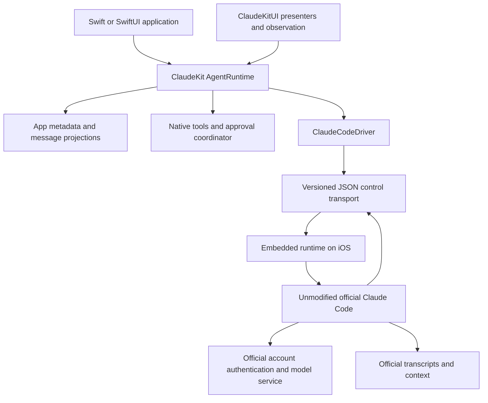

# ClaudeKit library implementation plan

Status: Core development alpha implemented on 18 October 2026. The runnable consumer app is [LibraryDemo](../../LibraryDemo/README.md), using the three public Swift package products. The sections below retain the wider implementation roadmap; they are not all claims of completed support.

The session-switching gate passed: one embedded Node host runs disposable Worker isolates around the unmodified official harness. The library demonstrated A → B → A, process restart recovery, approvals, denial, and cancellation on iOS simulator. The original Messages implementation is preserved under `ClaudeKitLegacy` / `ClaudeKitLegacyUI`. See the [current API and limitations](../../README.md) and [verification evidence](../../LibraryDemo/Evidence/README.md). Logout, expiry qualification, advanced requests, and release packaging remain open.

Build a Swift library with CodexKit's familiar integration pattern around the official Claude Code harness already demonstrated on iPhone. Apps should sign in with a Claude account, create conversations, stream replies, register Swift tools, present approvals, and restore their work through `AgentRuntime`. The harness retains ownership of authentication, model requests, agent iteration, and conversation context.

The first release should provide the core application API with one active execution at a time and multiple independently resumable conversations. Switching conversations without restarting the app is an early feasibility gate. Broader CodexKit features follow in explicit stages; unsupported features must be discoverable and return typed errors.

## Verified starting point

At the start of this plan, the Swift package and `HarnessDemo` were separate implementations. The package used `AnthropicMessagesBackend` and a Swift-managed runtime; the demo embedded the unmodified harness. The implemented alpha replaces that runtime ownership boundary and retains the old implementation under explicitly named legacy products.

On 15 October 2026, the physical iPhone tests established:

- Claude-account browser login and real Claude Sonnet 4.6 inference without supplying an API key.
- One native Swift write, one read, two manual approvals, and 124 streamed events.
- Account restoration and exact conversation recall after restarting into a new process, with no repeated tool calls.
- Unmodified Claude Code `2.1.112`, NodeMobile `18.19.1`, ICU `73.2`, JIT disabled, and matching Swift/Node process IDs.
- Resume after the app container moves, by resolving the existing transcript and using the harness's JSONL resume argument.

Evidence: [live turn](../../HarnessDemo/Evidence/iphone-account-tool-loop.json), [live resume](../../HarnessDemo/Evidence/iphone-account-resume.json), [device UI test](../../HarnessDemo/Evidence/ui-tests-iphone-account-summary.json), and [runtime provenance](../../HarnessDemo/ThirdParty/README.md).

The demo starts embedded Node once per app process. It has not established independent session switching within that process, concurrent conversations, cancellation recovery, credential refresh after expiry, or production memory behavior. The inspected control handler exposes interruption, model changes, and MCP management; that inspection did not identify a proven conversation-switch control. These limits determine the first implementation work.

## Product decisions

1. **Claude-account login is the default.** The harness performs its own browser flow, token exchange, persistence, and refresh. Apps receive account metadata and authentication state; account credentials are not exposed to app tools. Keep API-key authentication as an explicit optional mode.
2. **The official harness stays unchanged.** Runtime adapters and Swift bindings may change. Every distributed harness asset is pinned and verified by checksum. Swift never supplies a replacement model/tool loop.
3. **Match CodexKit's concepts and ordinary call sites.** Preserve names and behavior where they fit. Authentication setup and runtime ownership intentionally differ. Do not promise drop-in source compatibility with either CodexKit or the existing Messages-backed ClaudeKit package.
4. **Use a controlled release cycle.** Pin the harness, runtime, shims, and protocol adapter as a tested combination. A library update changes that combination deliberately; no runtime self-updater is enabled.
5. **Prioritize the iPhone path.** Target an iOS 18+ alpha initially, since the demo targets iOS 18 and has evidence on iOS 18.6 simulator and iOS 27.0.1 hardware. Qualify iOS 17 separately before advertising CodexKit's minimum OS. macOS 14+ is a planned transport with its own tests.
6. **Ship a limited tool surface first.** Apps provide capabilities through native MCP tools. Built-in shell tools, executable hooks, arbitrary plugins, subagents, and remote execution each require their own later validation.

## CodexKit feature mapping

| CodexKit capability | ClaudeKit implementation | Delivery |
| --- | --- | --- |
| `AgentRuntime.Configuration` | Driver, approvals, state store, instructions, tools, and execution limits | Core |
| `restore`, `signIn`, `currentSession`, `signOut` | Harness-owned authentication with an opaque account session | Core; logout and expiry need tests |
| `createThread`, `resumeThread`, thread catalog | App thread metadata mapped to official session IDs and relative transcript references | Core after session gate |
| `stream`, `send`, `sendWithSummary` | Typed mapping of harness events and final result | Core |
| `start` and `AgentExecution` | Execution ID, readiness, single event consumer, cancellation tied to that execution | Core |
| Swift tools and approvals | General SDK MCP registry, tool executors, and permission coordinator | Core |
| Thread model configuration | Model identifiers and supported controls from the pinned adapter | Core; unsupported options rejected |
| Persistent state and observation | File/in-memory stores initially; bounded queries and async snapshots | Core |
| `ApprovalInbox`, `AgentRuntimeStore` | Reuse the public concepts; add an official-login presenter | Core |
| SQLite and Realm persistence | Optional stores for app metadata, message projections, and memory | Later, SQLite first |
| Text plus image input | Map validated attachments into the official input protocol | Follow-on acceptance tests |
| Typed structured output | Harness-native schema support, then Swift validation and committed typed results | Follow-on acceptance tests |
| Personas, skills, app context | Instruction composition and enforceable native-tool policies | Later; semantics must be tested |
| Local memory | Optional Swift retrieval/capture backed by app stores | Later; distinct from harness context compaction |
| Model discovery and usage | Expose only metadata supplied by the harness/account | Capability-dependent |
| Steering and parallel tools | Capability-gated controls with execution IDs and bounded dispatch | Later |
| Parallel conversations | Multiple isolated harness sessions after resource/isolation qualification | Later; one active execution initially |
| Ephemeral requests | Separate disposable harness context; must not alter the active conversation | Later, depends on session isolation |
| Compaction, subagents, hosted search | Preserve harness behavior where validated; map observable events | Separate experiments |
| Codex-specific image generation, cloud bridge, device-code login | No assumed Claude equivalent | Outside the core release |

## Library architecture



The boundary is a `HarnessDriving` abstraction that starts/resumes a harness session, starts a turn, routes control messages, and reports capabilities. It does not accept an exported access token or ask Swift to schedule the next model call. Avoid forcing it into the existing credential-oriented `AgentBackend.beginTurn(history:session:)` contract.

Proposed package products:

| Product or target | Responsibility |
| --- | --- |
| `ClaudeKit` | Public models, runtime facade, driver protocol, execution handles, tool/approval contracts, store protocols, event mapping contracts |
| `ClaudeKitHarness` | Official protocol adapter, session coordinator, bootstrap resources, and platform transport factories |
| Internal iOS host target plus `NodeMobile` binary target | Embedded runtime lifecycle, pipes, thread configuration, compatibility adapters; conditionally linked for iOS |
| Internal macOS transport target | Launch a selected compatible local CLI using process pipes; no remote harness dependency |
| `ClaudeKitUI` | SwiftUI state adapter, approval inbox, official browser presenter, manual-code fallback UI |
| `ClaudeKitSQLite`, then `ClaudeKitRealm` | Optional persistence adapters after the core store contract stabilizes |

Core models and fake-driver tests must build without NodeMobile or proprietary assets. A consumer of the iOS harness product receives its complete resources and framework through SwiftPM. Resolve binary/resource packaging with a separate consumer app before expanding the API. A local bootstrap-based package is sufficient for development; public artifact hosting and redistribution are release work.

The current XCFramework contains arm64 iOS and arm64 iOS simulator slices, with no macOS slice. macOS therefore needs its own transport; importing that framework on macOS is not a solution. Pin a compatible local CLI for initial macOS qualification, and explicitly reject unknown protocol versions until an adapter is verified.

## Proposed app API

This is the original proposed API shape. See the root README and LibraryDemo for the implemented, compiling call sites; advanced methods below remain roadmap items.

```swift
import ClaudeKit
import ClaudeKitHarness
import ClaudeKitUI

let approvals = ApprovalInbox()
let signIn = ClaudeSignInCoordinator()
let driver = try ClaudeCodeDriver.embedded(configuration: .init(
    authentication: .claudeAccount,
    signInPresenter: signIn
))

let runtime = try AgentRuntime(configuration: .init(
    driver: driver,
    approvalPresenter: approvals,
    stateStore: FileRuntimeStateStore(),
    baseInstructions: "Help the user manage their notes."
))

try await runtime.restore()
let account = try await runtime.signIn() // metadata; no credential export
let thread = try await runtime.createThread(title: "Notes")
let execution = try await runtime.start(
    Request(text: "Summarize my notes"), in: thread.id
)
try await execution.waitUntilReady()
for try await event in execution.events {
    if case let .assistantMessageDelta(_, _, text) = event {
        // Update the app's UI.
    }
}

// UI actions may call execution.cancel() while the execution is active.
```

Also retain the simpler `runtime.stream(_:in:)` and `runtime.send(_:in:)` entry points. Tool registration keeps the existing `ToolDefinition` and executor shape, with credentials removed from the tool execution context. The host app presents the login and approval coordinators; the SDK core must not require a global key window or UIKit singleton.

Expose `runtime.capabilities()` for supported inputs, structured output, session switching, steering, and execution concurrency. Unsupported operations fail before a request is sent. Do not accept configuration values and silently ignore them.

## Session and execution design

The process-wide iOS host owns the Node lifecycle, environment setup, pipes, and resource budget. Multiple `AgentRuntime` facades cannot independently call `node_start` or overwrite process globals. Enforce one coordinated host and initially one active account configuration per app process; reject conflicting ownership explicitly.

Use distinct identifiers for app threads, official harness sessions, executions, control requests, and tool invocations. Tag incoming events with a host/session generation so an old approval reply or cancellation cannot affect a later execution.

The core release permits one active execution. A request for another conversation while busy returns a typed `runtimeBusy` error initially. Serial execution does not itself solve conversation switching: the session gate must demonstrate A → B → A in one app process.

Investigate session lifecycle in this order:

1. Exercise a supported switch/reset/restart interface in the pinned harness if one exists. Verify behavior; changing the `session_id` field of an input message is not evidence of isolated contexts.
2. If necessary, test a fresh JavaScript isolate or Worker for each harness session within the same native app process. Treat this as a runtime experiment: cwd/environment behavior, standard streams, filesystem paths, global shims, native modules, cleanup, and exit interception all need validation.
3. If neither works without modifying the harness, retain the demonstrated single-session alpha and report that full conversation switching needs additional runtime work. Re-estimate before expanding the library around an unproven host design.

Do not rely on repeated ES-module imports to reset singleton state, restart Node in place, force the host app to exit, or route execution to a remote server as an implicit fallback.

`AgentExecution` owns readiness, cooperative cancellation, bounded event delivery, and one terminal outcome. Breaking observation must not leave unbounded production running. A cancellation request is distinct from confirmed interruption; wait for the control/terminal response or report a timeout and host recovery requirement. A native tool may already have committed its side effect; never report that cancellation rolled it back.

## Authentication and stored state

Authentication states should include signed out, restoring, awaiting browser, signed in, reauthentication required, and failed. Account restore uses the harness's own account response. Browser cancellation and stale callbacks must settle the pending operation. Do not ask for an API key when account login fails.

Qualify the harness's refresh and logout paths before exposing them as dependable APIs. Login restoration proves persistence, not refresh after expiry. Do not invent logout control names. If changing accounts requires a new isolated session, the coordinator must enforce that barrier and prevent old requests from using the new account.

Keep credentials in the harness-owned private configuration directory with appropriate iOS data protection and backup exclusion. Do not introduce a second Swift token store or token-refresh loop. An account-scoped storage namespace binds metadata and transcripts to the authenticated identity where the harness exposes it; identity changes must not silently reuse another account's threads. Keep personal account metadata and authorization material out of diagnostics.

The harness's transcripts are authoritative for model context. Swift stores thread titles, UI message projections, execution receipts, and mappings to those transcripts. Persist transcript references relative to the SDK-owned directory so container relocation remains safe. Database adapters do not replace official transcript storage.

On recovery, reconcile durable execution receipts with official message/session IDs. Deduplicate replayed events and mark uncertain work interrupted; do not automatically resend a prompt or rerun a tool after an ambiguous crash. Displaying stored messages alone does not establish a successful harness resume. Transcript compatibility changes require an explicit migration or retained compatible runtime, not regeneration from the UI message list.

Thread deletion must account for the projection, transcript, attachments, and active-session lease. Deleting UI history alone must not claim that model context was erased. Message-level redaction that would require unsupported transcript editing stays unavailable until its semantics are established.

## Tools and permissions

Extract the demo's fixed `write_note`/`read_note` server into a registry of named Swift executors with JSON schemas, argument/result size bounds, cancellation contexts, and typed errors. Validate arguments before dispatch. Map MCP tool names back to stable app names in events and approval prompts.

Preserve the official permission request/response round trip. Tie each decision to the exact execution and tool call. Denial, dismiss, timeout, cancellation, and stale callbacks must all have defined outcomes. Host authorization is also checked at native dispatch so a tool cannot execute merely because a permission event was missed.

Freeze tool definitions for an active execution initially; apply registrations/replacements at the next supported session boundary. Later live updates can use verified MCP controls. Do not promise that the model has seen a new tool until the harness acknowledges the change.

Serial dispatch is the default. Later parallel execution requires both a host limit and per-tool opt-in, preserving approval and policy barriers. Tool executors own their application-specific access restrictions and idempotency. SDK receipts detect duplicates but cannot guarantee exactly-once effects across arbitrary external services.

## Implementation stages

| Stage | Deliverable | Acceptance criteria | Dependency |
| --- | --- | --- | --- |
| 1 Session feasibility | Small fixture-backed experiments around the current host | A → B → A with distinct random markers in one app process; no context leakage; cancel and run again; create/destroy sessions repeatedly without accumulating workers, timers, or descriptors | First |
| 2 Package extraction | Core driver protocol, transport, host target, pinned resources, and separate consumer app | App imports SwiftPM products and reproduces the existing fixture proof; no source copied from the demo into the consumer; hash mismatch and unsupported platform fail clearly | Can start around Stage 1; lifecycle design waits for its result |
| 3 Core runtime | Auth states, execution handles, thread catalog, stream/send helpers, generic tools, approvals, file persistence | Fixture tests cover normal/error/cancel paths; physical iPhone repeats account login, tool loop, A → B → A, restart recall, and account restoration | Stages 1–2 |
| 4 App integration and reliability | SwiftUI presenters, bounded observation, recovery, diagnostics, migration guide, library-powered demo | Cancellation races, slow consumers, network loss, lock/background/foreground, interrupted writes, stale approvals, and app update relocation have explicit tested outcomes | Stage 3 |
| 5 CodexKit expansion | Image input, typed JSON, SQLite, personas/skills, memory, then Realm and steering | Feature-specific contracts pass; capability flags only enabled after tests; typed results commit only after validation and official turn success | Stable core; features released independently |
| 6 Platform and release qualification | macOS transport, supported OS matrix, release artifact pipeline, performance report | Fresh consumer builds, verified artifacts, signing/entitlements, release device tests, and documented distribution conditions | Core readiness; public release also requires packaging qualification |

Stage 1 completion is mandatory for advertising multiple conversations. If it fails, a single-session alpha remains useful but must clearly report that limitation. Successful session switching does not automatically enable concurrent sessions.

For Stage 5, native JSON schema support exists in the pinned CLI argument surface, but schema changes, tool interaction, and streamed-result semantics still need device tests. Start with one validated final `Decodable` result. Add provisional typed events, JSON Lines, and other codecs only after defining completion and failure behavior. Avoid host-generated repair turns hidden behind a successful result.

Personas and skills need proven session/turn instruction mechanisms and native-tool enforcement. Start with runtime and thread instructions. Delay per-turn overrides if they would silently persist into later turns. Memory retrieval can supply explicit turn context; automated capture and compaction remain separate features. Do not let a custom Swift compaction loop compete with the official harness.

## Verification and release criteria

Testing has three distinct levels:

- **Swift contract tests:** fake driver, typed event ordering, cancellation ownership, tool routing, validation, store reconciliation, and capability errors. These verify the library's responsibilities.
- **Real harness with local model fixture:** unmodified CLI performs the loop against deterministic responses, including multi-step tools, denial, malformed events, errors, resume, and session isolation. These verify protocol integration without consuming an account.
- **Explicit live device tests:** user-owned account, browser login, restore, refresh/reauthentication when exercised, real tools, recall, interruption, and lifecycle. Keep these opt-in and separate from ordinary CI; a skipped live test does not count as a pass.

Add a release checklist with concrete pass criteria:

1. Fresh consumer app builds using only documented SwiftPM products and required host configuration.
2. Official harness hash matches the selected release manifest before startup.
3. Two conversations retain different markers through repeated switches, cancellation, and process restart.
4. A denied tool performs zero side effects; a stale approval cannot authorize a newer call.
5. Readiness, terminal events, and cleanup settle once, including with an unconsumed or overflowing event stream. Never silently discard protocol bytes as the demo currently does for an oversized partial line.
6. App update/container relocation preserves account and conversation recovery; incomplete writes fail visibly without replaying effects.
7. Logs and exported diagnostics omit credentials, authorization codes/URLs, and conversation bodies by default.
8. Measure startup latency, peak and idle resident memory, time to first output, binary size, and memory after at least 20 session changes on the oldest supported device. Set numeric release budgets from those measurements before promotion. Test release builds without a debugger and both with/without optional memory entitlements to establish actual requirements.
9. Background suspension and device lock produce bounded, recoverable behavior. Do not promise continued generation after iOS suspends or terminates the app. Long-running remote jobs are a separate product.
10. Compile and execute the supported OS/architecture matrix. Swift-only tests passing on macOS are not evidence that the embedded iOS runtime works there.

Before publishing bundled proprietary artifacts, resolve the chosen distribution arrangement, retain component licenses/notices, and qualify TestFlight/App Store delivery with the actual archive. Technical device success is not a distribution decision. These release questions do not prevent local library development.

## File changes and migration

| Existing area | Planned change |
| --- | --- |
| `Package.swift` | Add optional harness product, platform host targets, resources, and tests; keep the core independently buildable |
| `Sources/ClaudeKit/Runtime/AgentRuntime.swift` | Split facade, execution control, thread management, and observation; delegate agent work to the driver |
| `Sources/ClaudeKit/Runtime/AgentBackend.swift` | Introduce the harness lifecycle contract; avoid repurposing a credential/history transport contract |
| `Sources/ClaudeKit/Auth` | Add opaque account session and state types; separate legacy API credentials from harness auth |
| `Sources/ClaudeKit/Tools`, `Approval` | Reuse public concepts, add generation-scoped routing and dispatch authorization |
| `Sources/ClaudeKitUI` | Keep approval/store concepts and add official browser presentation |
| New `Sources/ClaudeKitHarness` and platform host targets | Extract `HarnessHost` into focused lifecycle, transport, auth, event, MCP, and session components |
| `HarnessDemo/Runtime` | Move production adapters into package resources while retaining a fixture-only test path |
| `HarnessDemo` | Preserve its proven behavior and evidence, then make it a thin consumer of the package |
| `DemoApp` | Move to the new runtime after the core passes; each advanced demo feature is gated by actual support |
| `Tests` and new `Scripts` | Driver contracts, protocol fixture runs, isolated consumer builds, signed device/simulator verification, artifact checks |
| Root README and guides | Replace the current Messages-only quickstart when the harness-backed package is usable; document intentional API differences |

Keep the legacy Messages implementation available under an explicit legacy module/product during migration if existing consumers need it. It must never be an automatic fallback from a harness failure. Keep existing legacy history separate; there is no proven conversion from those UI histories to an official harness session. Decide the release version and deprecation schedule when actual consumers are identified.

Reuse CodexKit's interface patterns and relevant contract tests after checking the applicable source license. Avoid a dependency on the entire CodexKit package or a shared agent-loop implementation. Do not extract a new cross-provider framework before this integration stabilizes.

## Work order and estimate

Start with Stage 1 and a minimal external consumer for Stage 2. Then extract the proven single-session transport, introduce the public facade, generalize tools/approvals, and add durable thread mappings. Add UI and recovery only against that tested core. Expand feature parity in separate increments.

A thin single-session package is a few focused development days of extraction. A core release with session switching and reliability work is a planning allowance of roughly **3–6 engineering weeks**, assuming the lifecycle experiment succeeds without a new native runtime implementation. Stage 1 should be a bounded **2–4 day investigation**, ending in a working approach or a documented limitation and revised estimate. Full CodexKit feature parity and distribution review have separate schedules.

The completion target for the core is concrete: a new iOS app imports ClaudeKit, signs in through the official harness, switches between two persistent conversations, streams real replies, executes approved Swift tools, cancels a turn, and resumes after restart using only public library APIs.

## Reference material

- [Harness demo and verified scope](../../HarnessDemo/README.md)
- [Investigation and pinned distribution details](../investigations/official-claude-code-on-ios.md)
- [CodexKit SDK integration](/Users/tima/Projects/AssistantAI/CodexKit/docs/sdk-integration.md)
- [CodexKit capabilities](/Users/tima/Projects/AssistantAI/CodexKit/docs/index.md)
- [CodexKit persistence](/Users/tima/Projects/AssistantAI/CodexKit/docs/persistence.md)
- [CodexKit execution handles](/Users/tima/Projects/AssistantAI/CodexKit/Sources/CodexKit/Runtime/AgentExecution.swift)
