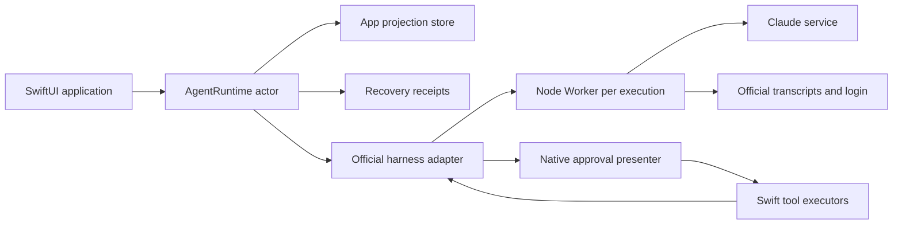

# Runtime architecture

[Documentation index](index.md)

ClaudeKit integrates an official model/tool loop with native application capabilities. It does not implement a second Swift inference loop.

## SDK modules

Apps import `ClaudeKit`, which re-exports the core API and the default harness adapter. Internally, `ClaudeKitCore` contains the runtime contracts and `ClaudeKitHarness` depends on that core, avoiding a circular dependency.

Imports do not launch the host. Constructing the default configuration creates its driver and storage directories; calling `runtime.restore()` opens the harness and restores account state.

## Ownership boundaries

The harness owns account authentication, provider requests, tool iteration and model conversation state. Swift owns app-facing threads/messages, tool schemas/executors, approval presentation, policy enforcement and output validation/storage.

On iOS one embedded Node host serves independent logical channels. Each execution uses a Worker isolate. Filesystem shims resolve relative operations against that worker's logical workspace; this is path routing, not a security sandbox. macOS development uses a process transport with an explicit Node executable.

The pinned official CLI is unmodified. Host shims bridge unsupported platform functions and native tool control. Version updates should be qualified with the fixture/provenance tests rather than changing the CLI in place.

## Execution and commit

An execution reserves its thread, freezes request policy and obtains a session driver. It materializes lazy history if needed, persists app input for ordinary turns, then opens/resumes the harness. Native calls pass through approval and executor boundaries.

The adapter observes final results and, for persistent turns, waits for confirmation of the final assistant transcript entry. Typed output must finish validation before app output commit. The app then persists the assistant/output/usage projection and emits completion. Streaming events precede this durable boundary.

Independent threads can run simultaneously. Writes are serialized in submission order so an older snapshot cannot finish after a newer one and overwrite it. A failed write requires restoration. This is not a distributed transaction across the provider, transcript filesystem and app database.

## Durability boundaries

A tool side effect can complete before model output or app persistence fails. Cancellation cannot roll it back. Durable recovery therefore excludes tool effects. Remote receipts also distinguish interrupted work from completed results; neither subsystem promises exactly-once inference.

Database projection stores, memory records and output codecs are currently ClaudeKit implementations. Shared memory/storage libraries with CodexKit are a potential future extraction, not an existing dependency or compatibility guarantee.
